<div align="center">

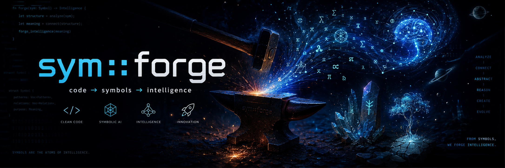

# SymForge

**Symbol-aware code intelligence, zero-egress Code Mode, and structural editing for AI coding agents — local-first, trust-labeled, token-efficient.**

[](https://www.npmjs.com/package/symforge)
[](https://github.com/special-place-ai-heaven/symforge/actions/workflows/ci.yml)
[](./LICENSE)
[](./rust-toolchain.toml)
[](https://modelcontextprotocol.io)
[](#install-and-quick-start)

[Install](#install-and-quick-start) · [How it works](#how-it-works) · [Code Mode & CLI](#code-mode-and-cli) · [Tools & Surfaces](#tools-and-surfaces) · [Embed](#embedding) · [Wiki](https://github.com/special-place-ai-heaven/symforge/wiki)

</div>

---

SymForge gives an AI coding agent a symbol-level view of a repository so it can ask structured questions instead of reading whole files, running broad greps, or editing code with blind string replacement. Written in Rust and parsed with tree-sitter, the 12.0.0 engine runs in three lanes:

- **MCP server** (`full`, `code`, `core`, or `compact` surface over stdio or Streamable HTTP), backed by an optional shared local daemon.
- **Zero-egress CLI & `SKILL.md`** (`symforge code` and `symforge q`), for shell-capable agents that want typed symbol queries and single-turn multi-step chaining with zero upfront MCP schema tokens.
- **In-process Rust library** (`symforge::embed`), compiling the indexing, search, git, and edit core without the server or CLI.

Every MCP answer carries a machine-readable **trust envelope**: match type, source authority, completeness, and `file:line` evidence. When SymForge cannot answer exhaustively, it says so rather than guessing.

> [!IMPORTANT]
> SymForge is for **code intelligence and structural code editing**. Prefer it to whole-file reads, broad text scans, or string-replace edits when inspecting or changing source code. Use the shell for builds, tests, package managers, and exact literal match counts (`rg -c` / `grep`), and use raw file reads when inspecting literal docs, config prose, or several nearby regions of one small file.

## Why SymForge

Coding agents spend most of their context window *finding* code, not changing it. SymForge replaces raw file haystacks and multi-turn grep loops with in-memory AST slices, a pure-Rust single-turn query VM, and syntax-verified structural edits:

<p align="center">
  <picture>
    <source media="(prefers-color-scheme: dark)" srcset="./docs/diagrams/symforge-surgical-precision-dark.svg">
    <source media="(prefers-color-scheme: light)" srcset="./docs/diagrams/symforge-surgical-precision-light.svg">
    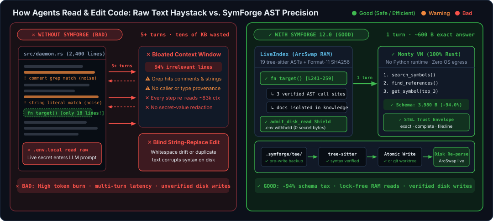
  </picture>
</p>

<p align="center">
  <picture>
    <source media="(prefers-color-scheme: dark)" srcset="./docs/diagrams/symforge-capabilities-grid-dark.svg">
    <source media="(prefers-color-scheme: light)" srcset="./docs/diagrams/symforge-capabilities-grid-light.svg">
    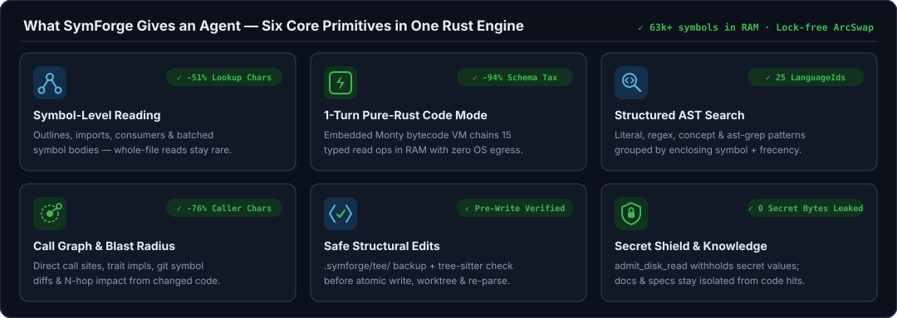
  </picture>
</p>

Details: [Home, Why SymForge](https://github.com/special-place-ai-heaven/symforge/wiki/Home#why-symforge) and [What it gives an agent](https://github.com/special-place-ai-heaven/symforge/wiki/Home#what-it-gives-an-agent).

## How it works

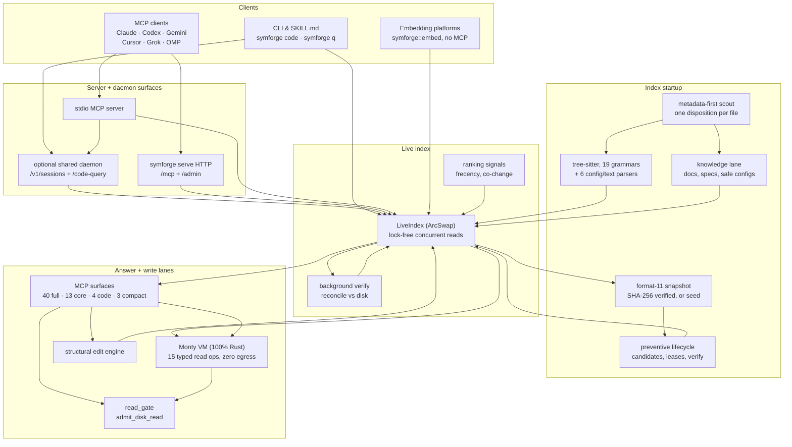

`LiveIndex` publishes immutable index generations through `ArcSwap`, giving zero reader contention under concurrent tool calls while background reconciliation or file-watcher updates swap in new generations atomically. Every lane that reopens bytes from disk passes through `admit_disk_read`, which classifies the exact buffer read and returns content only on a permit. A format-11 snapshot lets startup skip cold parsing and reconcile against disk in the background (`SnapshotRestore` / `Pending` until verified). After any edit, the index rebuilds from the bytes that landed on disk, never from an in-memory buffer.

Details: [Architecture, How it works](https://github.com/special-place-ai-heaven/symforge/wiki/Architecture-and-How-It-Works#how-it-works), [The life of an edit](https://github.com/special-place-ai-heaven/symforge/wiki/Architecture-and-How-It-Works#the-life-of-an-edit), and [What makes it different](https://github.com/special-place-ai-heaven/symforge/wiki/Architecture-and-How-It-Works#what-makes-it-different).

## Install and quick start

Prerequisite for prebuilt binaries: Node.js 18+ and npm on **Windows x64** (`symforge-windows-x64`) or **Linux x64** (`symforge-linux-x64`).

```bash
npm install -g symforge
symforge --version
symforge init                            # register installed MCP clients
symforge init --code-skill               # also write symforge-code/SKILL.md (Claude, Codex, OMP)
symforge init --code-skill --skill-only  # zero-MCP setup: write SKILL.md only, touch no MCP config
```

npm installs a thin launcher plus the OS-native binary inside npm's global prefix (`~/.symforge/bin` is retired), with no postinstall hook and no config edits until `symforge init`. Run `symforge update` to upgrade safely while MCP sessions remain open (cleaning retired `~/.symforge/bin` leftovers only after confirmed client re-registration):

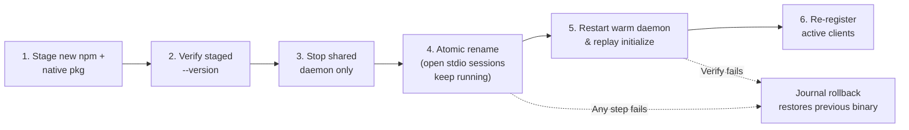

**macOS and source builds.** Prebuilt macOS npm packages are not shipped; on macOS or other architectures, build from a git checkout (`cargo build --release`, requires Rust 1.100.0 and a C toolchain for tree-sitter, libgit2, and bundled SQLite) or run `cargo install symforge`. A git checkout keeps the `[patch.crates-io]` `rmcp 3.10.0` patch (`vendor/rmcp/SYMFORGE-PATCH.md`). Cargo ignores `[patch]` on crates.io installs, so `cargo install symforge` lacks two pre-handshake fixes (ignoring `notifications/cancelled` after a timed-out `server/discover` before `initialize`, and clearing the `OnceLock` inline protocol latch when a `2026-07-28` `_meta` request precedes `initialize`).

> [!CAUTION]
> **WSL:** if the shell inherits the Windows npm prefix, `npm install -g` pulls `symforge-windows-x64` and Linux launches fail looking for `symforge-linux-x64`. Put a native Linux npm prefix ahead of `/mnt/*` entries on `PATH`, then reinstall.

To steer MCP agents explicitly, add the [Agent Setup Prompt](https://github.com/special-place-ai-heaven/symforge/wiki/Agent-Setup-Prompt#the-prompt) to your client instructions.

Details: [Install and Client Setup, Install](https://github.com/special-place-ai-heaven/symforge/wiki/Install-and-Client-Setup#install) and [Troubleshooting](https://github.com/special-place-ai-heaven/symforge/wiki/Install-and-Client-Setup#troubleshooting).

## Code Mode and CLI

Loading all 40 MCP schemas costs ~16.5k tokens up front (`66,181 B`), and chaining discovery -> references -> symbol bodies over individual MCP calls spends a full model turn per step. V12 eliminates both costs with a **100% pure-Rust bytecode VM** (`monty`, compiled straight into the `symforge` binary—**no Python runtime or interpreter is installed or spawned**; Python-subset syntax is simply the compact query grammar the LLM writes):

1. **MCP `code` surface** (`SYMFORGE_SURFACE=code` or `symforge serve --surface code`): advertises 4 tools (`code_search`, `code_execute`, `symforge_edit`, `status`) in **3,980 B** (~995 tokens, **−94.0%** vs `full`).
2. **Shell CLI + `SKILL.md`** (`symforge init --code-skill --skill-only`): zero MCP tools, invoking `symforge q` for single queries and `symforge code run` for multi-step scripts against the warm daemon (`/v1/sessions/{id}/code-query`, preserving `ProjectEvidence`) or read-only `.symforge/index.bin`.

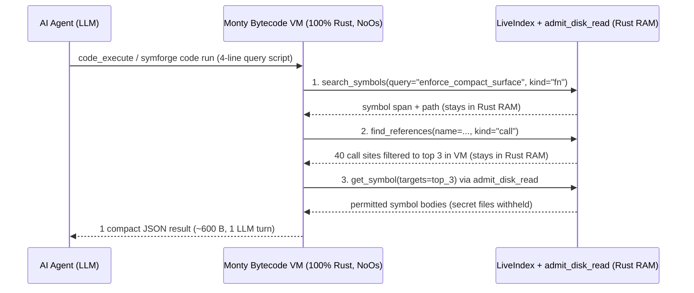

```bash
# Single quote-free query (parses JSON scalars/arrays or falls back to string; works in bash, cmd, PowerShell)
symforge q search_symbols -a query=execute_script -a kind=fn

# Multi-step chain in one turn (prefer stdin `-` or `-f` on Windows so symforge.cmd never truncates newlines)
symforge code run - <<'PY'
hits = search_symbols(query="enforce_compact_surface", kind="fn")
refs = find_references(name="enforce_compact_surface", kind="call", path=hits[0]["path"])
targets = [{"path": r["path"], "name": r["enclosing_symbol"]} for r in refs[:3] if r["enclosing_symbol"]]
{"defined_in": hits[0]["path"], "caller_bodies": get_symbol(targets=targets)}
PY
```

Inspect signatures and `TypedDict` return shapes with `symforge code stubs [QUERY] [--limit N]` and chaining patterns with `symforge code idioms`. The sandbox exposes **15 keyword-only read operations** (`search_symbols`, `get_symbol`, `find_references`, `find_dependents`, `file_context`, `file_content`, `search_text`, `search_files`, `repo_map`, `symbol_context`, `inspect_match`, `what_changed`, `diff_symbols`, `detect_impact`, `search_knowledge`). It has **zero filesystem, network, environment, or subprocess access** (`import os` fails with `PermissionError`), enforces `10s` CPU/wall (`30s` ceiling), `64 MiB` memory (`256 MiB` ceiling), recursion depth `150` (`200` ceiling), `64` host calls (`256` ceiling), and `16,000` inline chars (spilling full JSON to a temp file locally; disabled on HTTP `serve`), passes every read through `admit_disk_read`, never bumps frecency on discovery ops, and emits single-line JSON on `stdout` with exit code `1` whenever `"status": "error"`.

Details: [Tool Reference, Code Mode and CLI](https://github.com/special-place-ai-heaven/symforge/wiki/Tool-Reference#code-mode-and-cli).

## Clients

`symforge init` supports 13 MCP clients: `claude`, `claude-desktop`, `codex`, `gemini`, `grok`, `kilo-code`, `cursor`, `omp`, `cline`, `roo`, `vscode`, `copilot`, `continue`. Bare `symforge init` (`--client all`) configures installed user-scope clients, prints `skipped:` for absent ones (always including `skipped: Kilo Code ...`), and never writes workspace-local configs (`kilo-code`, `roo`, `vscode`, `continue`) unless you name `--client <name>` inside that repository. `symforge init --scan` previews HTTP attach state without writing (`--apply --serve-url <URL>` writes it). `--code-skill` writes `symforge-code/SKILL.md` into `~/.claude/skills/` (honoring `CLAUDE_CONFIG_DIR`), `~/.codex/skills/`, and `~/.omp/agent/skills/`.

Top-level CLI subcommands: `init`, `code` (`run`, `stubs`, `idioms`), `q` (alias `query`), `serve` (Streamable HTTP `/mcp` + `/admin`, default `[IP_ADDRESS]:8787`), `daemon`, `setup`, `admin`, `hook`, `trust`, `analytics`, and `update`.

Details: [Configure a client](https://github.com/special-place-ai-heaven/symforge/wiki/Install-and-Client-Setup#configure-a-client), [Workspace-local clients](https://github.com/special-place-ai-heaven/symforge/wiki/Install-and-Client-Setup#workspace-local-clients), and [Commands](https://github.com/special-place-ai-heaven/symforge/wiki/Install-and-Client-Setup#commands).

## Tools and surfaces

`SymForgeServer` registers **43 tools** across four `SYMFORGE_SURFACE` (`serve --surface`) profiles, alongside the zero-MCP CLI skill:

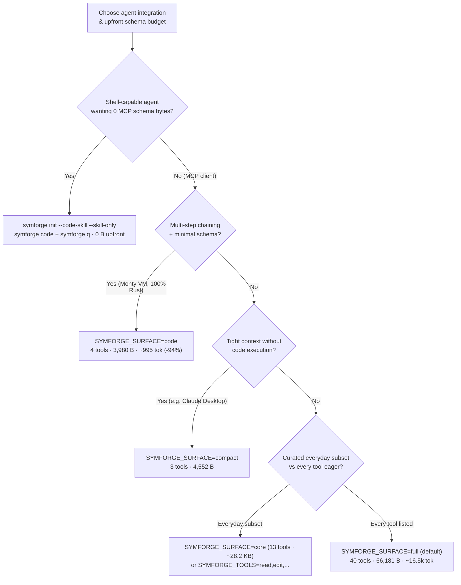

<p align="center">
  <picture>
    <source media="(prefers-color-scheme: dark)" srcset="./docs/diagrams/symforge-surface-scale-dark.svg">
    <source media="(prefers-color-scheme: light)" srcset="./docs/diagrams/symforge-surface-scale-light.svg">
    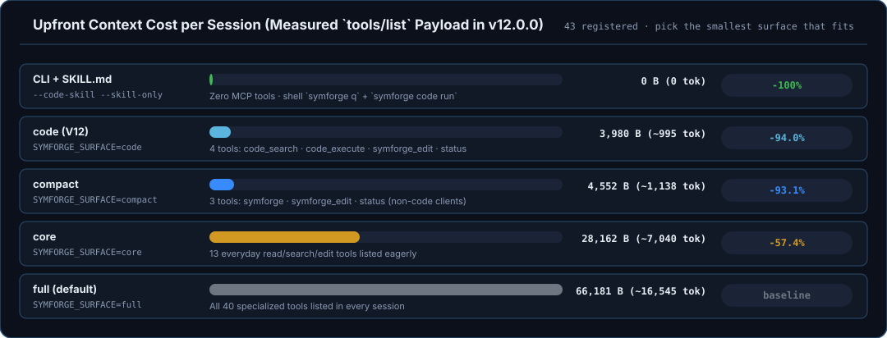
  </picture>
</p>

- **`full`** (default, **40 tools**, `66,181 B` / ~16.5k tok): 6 resources, 4 resource templates, 8 prompts; omits `symforge`, `code_search`, and `code_execute`.
- **`code`** (**4 tools**: `code_search`, `code_execute`, `symforge_edit`, `status`; **3,980 B** / ~995 tok): 2 resources (`symforge://tools/catalog`, `symforge://glossary`), 0 templates, 8 prompts; dispatch-rejects unlisted tools.
- **`core`** (**13 tools**, ~28.2 KB: `status`, `get_repo_map`, `get_file_context`, `get_file_content`, `search_text`, `search_symbols`, `get_symbol`, `find_references`, `replace_symbol_body`, `edit_within_symbol`, `batch_edit`, `index_folder`, `symforge_retrieve`): 6 resources, 4 templates, 8 prompts; unlisted full-surface tools stay callable by name (`symforge` still refuses outside `compact`).
- **`compact`** (**3 tools**: `symforge`, `symforge_edit`, `status`; **4,552 B**): 6 resources, 4 templates, 8 prompts; dispatch-rejects unlisted tools.

| Group | Full-surface tools (40) |
|---|---|
| **Orient** | `health` · `health_compact` · `status` · `get_repo_map` · `explore` · `ask` · `conventions` · `context_inventory` · `investigation_suggest` |
| **Read** | `get_file_context` · `get_file_content` · `get_symbol` · `get_symbol_context` · `inspect_match` |
| **Search** | `search_symbols` · `search_text` · `search_files` · `symforge_retrieve` |
| **Knowledge** | `search_knowledge` · `review_knowledge` · `curate_knowledge` |
| **Trace impact** | `find_references` · `find_dependents` · `what_changed` · `diff_symbols` · `analyze_file_impact` · `detect_impact` · `validate_file_syntax` |
| **Edit** | `edit_plan` · `replace_symbol_body` · `edit_within_symbol` · `insert_symbol` · `delete_symbol` · `batch_edit` · `batch_insert` · `batch_rename` · `symforge_edit` · `secret_remediate` |
| **Index** | `index_folder` · `checkpoint_now` |

The protocol layer runs on vendored `rmcp 3.10.0`, serving MCP **2026-07-28** alongside `2025-11-25`, `2025-06-18`, `2025-03-26`, and `2024-11-05` from a frozen allow-list.

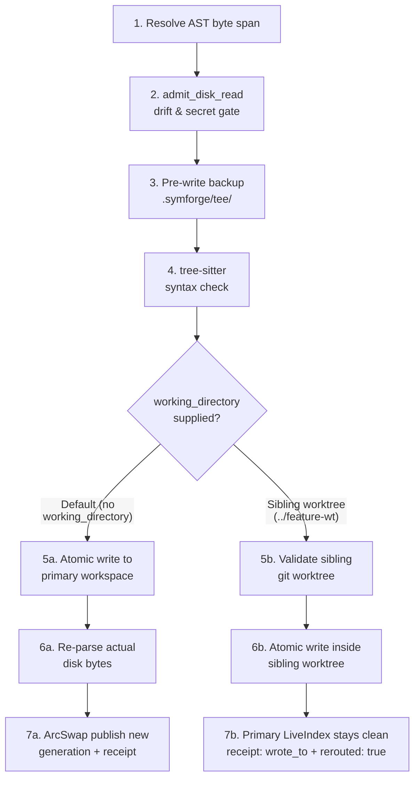

The seven structural edit tools (`replace_symbol_body`, `edit_within_symbol`, `insert_symbol`, `delete_symbol`, `batch_edit`, `batch_insert`, `batch_rename`) accept an optional `working_directory` naming a sibling git worktree (`symforge_edit` accepts and forwards it unadvertised), e.g. `{"path": "src/lib.rs", "symbol_name": "hello", "new_body": "fn hello() {}", "working_directory": "../feature-wt"}`. SymForge requires explicit call-time consent (`SYMFORGE_WORKTREE_AWARE`), rebase-splices single-symbol edits onto the worktree file, leaves the primary index untouched, and reports `wrote_to`, `indexed_path`, and `rerouted`.

Details: [Tool Reference](https://github.com/special-place-ai-heaven/symforge/wiki/Tool-Reference#the-tool-surface), [Protocol](https://github.com/special-place-ai-heaven/symforge/wiki/Tool-Reference#protocol), [Compact surface](https://github.com/special-place-ai-heaven/symforge/wiki/Tool-Reference#compact-surface), and [Runtime Model, Worktree-aware editing](https://github.com/special-place-ai-heaven/symforge/wiki/Runtime-Model#worktree-aware-editing).

## Embedding

Building with `--no-default-features --features embed` compiles the parsing, indexing, search, editing, and git core without the daemon, sidecar, protocol server, Monty sandbox, or CLI:

```toml
symforge = { version = "12", default-features = false, features = ["embed"] }
```

Open an `EmbeddedSourceHandle` via `ProcessIndexRuntime`: search returns claims with provenance, refresh returns a receipt, and refusals use `SourceRefusalKind`. `symforge::embed` is semver-public and pinned by compile-time contract tests; `symforge::embed::parity` (versioned by `API_VERSION`) exposes the MCP tool, resource, and prompt contracts in-process (known gaps in the [parity census](./docs/reviews/2026-10-10-embed-parity-gap-matrix.md); V11 lifecycle migration notes in [docs/migrations/v11-index-lifecycle.md](./docs/migrations/v11-index-lifecycle.md)).

Details: [Embedding the Engine, Build and dependency](https://github.com/special-place-ai-heaven/symforge/wiki/Embedding-the-Engine#build-and-dependency) and [MCP parity](https://github.com/special-place-ai-heaven/symforge/wiki/Embedding-the-Engine#mcp-parity-embedparity).

## Index lifecycle and recovery

```mermaid
%%{init: {"flowchart": {"htmlLabels": false, "wrappingWidth": 300}}}%%
flowchart TD
    accTitle: Preventive index lifecycle, format-11 snapshot, and secret admission gate
    accDescr: Startup checks .symforge/index.bin for format-11 version, SHA-256 checksum, and dismissal-store digest, either restoring immediately as SnapshotRestore / Pending while background verify reconciles against disk into a Ready ArcSwap generation, or quarantining older/corrupt files before a cold tree-sitter parse. Every disk read passes admit_disk_read, serving clean or identifier-only code and withholding secret values as MetadataOnly with rule and line metadata.

    subgraph Lifecycle["Startup & format-11 snapshot publication"]
        BIN[".symforge/index.bin"] --> VALID{"Format-11 + SHA-256 +\ndismissal digest valid?"}
        VALID -- "Yes" --> RESTORE["Restore immediately\n(SnapshotRestore / Pending)"]
        RESTORE --> RECON["Background reconcile\nvs disk"]
        VALID -- "No (older seed or corrupt)" --> COLD["Preserve in .symforge/quarantine/\n& cold tree-sitter parse"]
        RECON --> READY["Promote complete candidate\nvia ArcSwap (Ready)"]
        COLD --> READY
    end

    subgraph Admission["Secret admission gate (admit_disk_read)"]
        READ["Disk bytes read"] --> SEC{"Secret value\ndetected?"}
        SEC -- "Clean (or identifier name only)" --> SERVE["Serve source /\nAST symbols"]
        SEC -- "Secret value found" --> HOLD["Withhold content (MetadataOnly)\n+ report rule & lines in _meta"]
    end
```

Under V11's **preventive index lifecycle**, incomplete observations never publish as current and unverified answers declare their state. **Snapshot format 11** (`SNAPSHOT_FORMAT_VERSION = 11`) binds the secret-dismissal store digest (format 10) plus a full-payload SHA-256 checksum; snapshots below format 11 are refused before decode (V10 format-7 seeds keep rollback copies under `.symforge/v11/quarantine/index-snapshots/`), and secret-withheld files report rule IDs and line numbers in `_meta["symforge/withheld"]` without exposing secret bytes.

**Recovery:** `checkpoint_now(verify_after_write=true)` writes and verifies byte-for-byte; `health` or `health_compact` report load source, verification state, and mismatch paths; corrupt or incompatible snapshots move to `.symforge/quarantine/index-snapshots/`. To force a cold rebuild from source, start the server with `SYMFORGE_INDEX_FOLDER_RESET=1`, call `index_folder`, and unset the variable afterwards; use `index_folder` reset when health, verification, or quarantine evidence shows the snapshot is not a valid recovery source. `repair_index` is intentionally retired; `get_index_run` and `cancel_index_run` remain retired. No durable run IDs are exposed: recovery is a sequence you drive, not a job you poll.

Details: [Runtime Model, Index lifecycle (V11)](https://github.com/special-place-ai-heaven/symforge/wiki/Runtime-Model#index-lifecycle-v11) and [Recovery](https://github.com/special-place-ai-heaven/symforge/wiki/Runtime-Model#recovery).

## Configuration

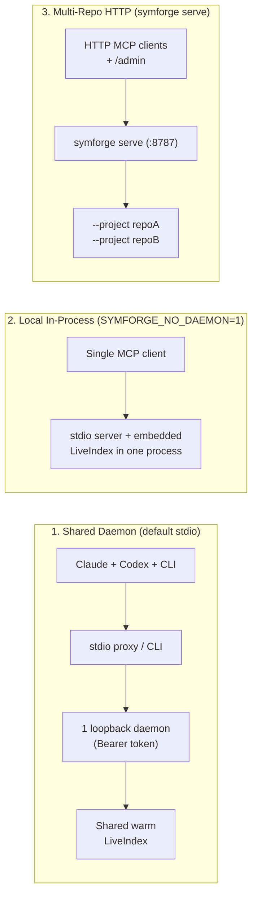

Workspace state lives under `.symforge/`: `index.bin` and `quarantine/`, pre-write `tee/` copies, `idempotency/` records, and optional `frecency.db` and `coupling.db` stores. The 12.0.0 server records no analytics and creates no `analytics.db`. Nothing leaves the machine.

| Variable | Effect |
|---|---|
| `SYMFORGE_HOME` | Control-plane home for daemon metadata and locks (default `~/.symforge`) |
| `SYMFORGE_SURFACE` | MCP surface profile: `full` (40 tools, default), `code` (4 tools), `core` (13 tools), or `compact` (3 tools). `serve --surface` overrides it for that process; `symforge init` records any active value in the client's `env` block |
| `SYMFORGE_TOOLS` | Per-process allow-list of comma-separated full-surface tool names or topic groups (`read`, `edit`, `knowledge`, `impact`, `service`); `serve --tools <list>` overrides it. Filters `full` (not a read-only sandbox: `secret_remediate`, `index_folder`, and `curate_knowledge` write outside `edit`), conflicts with `SYMFORGE_SURFACE=code`/`core`/`compact`, fails startup on `serve` when empty/unknown, and does not govern hooks, CLI, or `embed` |
| `SYMFORGE_NO_DAEMON` | Any value other than empty, `0`, or `false` forces local in-process mode (`symforge init` sets `1` for Codex on Linux) |
| `SYMFORGE_DAEMON_AUTH_TOKEN` | Bearer token required by the daemon on every route except `/health` (generated at daemon start when unset) |
| `SYMFORGE_INDEXING_THREADS` | Worker count for each of the two rayon pools (indexing and query, up to 2× workers total); useful on tight-RAM hosts and PID-1 containers |
| `SYMFORGE_WORKTREE_AWARE` | Controls `working_directory` edit routing; enabled when unset, disabled by any value other than empty, `1`, `true`, `yes`, `on`, or `explicit` |

`symforge serve --project ALIAS=PATH` (repeatable) serves multiple non-nested repositories from one HTTP process. Clients pass `project: ALIAS` (or `projects` on `search_symbols`, `search_text`, `find_references`, and `search_files`; `?project=ALIAS` on resources). With multiple projects configured, omitting `project` is refused except on `status`, `health`, and `health_compact`; prompts and `index_folder` are disabled (`--allow-index-folder` enables `index_folder` for single-project `serve` only), and worktree edits cannot route outside listed roots.

> [!WARNING]
> The daemon and `serve` HTTP are local coordination surfaces, not public internet APIs. The daemon binds loopback only unless `SYMFORGE_DAEMON_ALLOW_NON_LOOPBACK` is set, which logs an explicit warning.

Details: [Environment Setup Scripts, Variable reference](https://github.com/special-place-ai-heaven/symforge/wiki/Environment-Setup-Scripts#variable-reference), [Network exposure](https://github.com/special-place-ai-heaven/symforge/wiki/Environment-Setup-Scripts#network-exposure), and [Runtime Model, Serving modes](https://github.com/special-place-ai-heaven/symforge/wiki/Runtime-Model#serving-modes).

## Benchmarks

SymForge is built for large repositories and large source files—saving context bytes and model turns on symbol/caller navigation while reporting honest trade-offs where plain shell tools win:

<p align="center">
  <picture>
    <source media="(prefers-color-scheme: dark)" srcset="./docs/diagrams/symforge-v12-token-savings-dark.svg">
    <source media="(prefers-color-scheme: light)" srcset="./docs/diagrams/symforge-v12-token-savings-light.svg">
    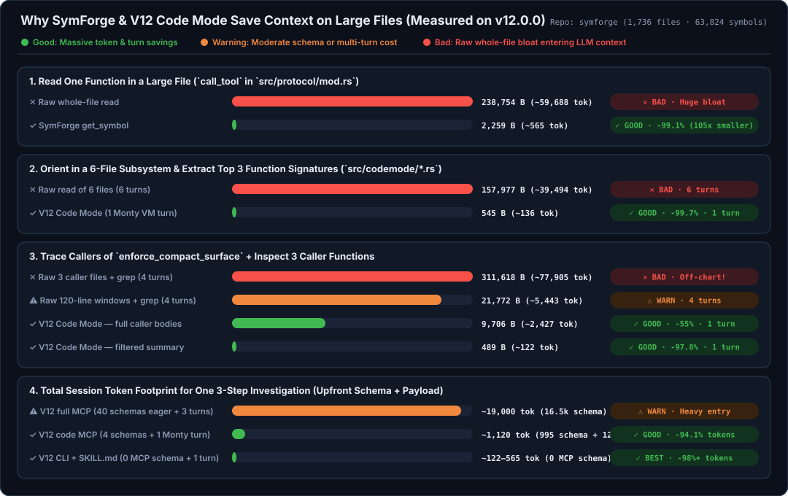
  </picture>
</p>

<p align="center">
  <picture>
    <source media="(prefers-color-scheme: dark)" srcset="./docs/diagrams/symforge-polyglot-rtk-dark.svg">
    <source media="(prefers-color-scheme: light)" srcset="./docs/diagrams/symforge-polyglot-rtk-light.svg">
    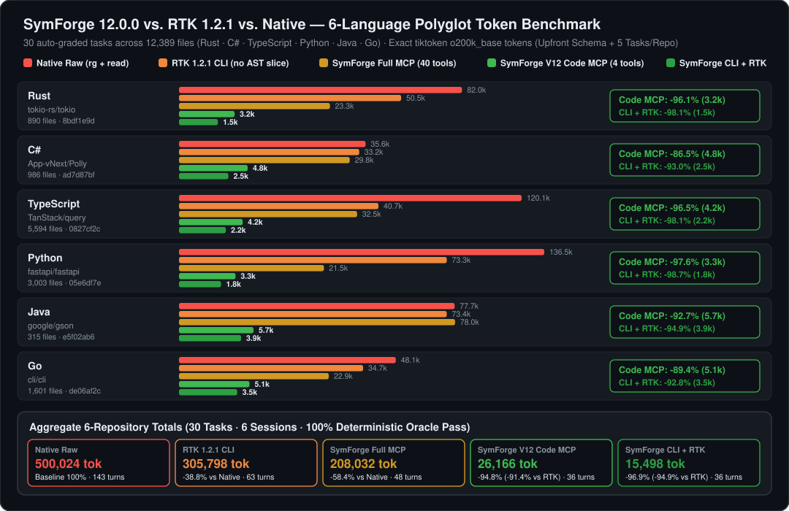
  </picture>
</p>

<p align="center">
  <picture>
    <source media="(prefers-color-scheme: dark)" srcset="./docs/diagrams/symforge-benchmark-audit-dark.svg">
    <source media="(prefers-color-scheme: light)" srcset="./docs/diagrams/symforge-benchmark-audit-light.svg">
    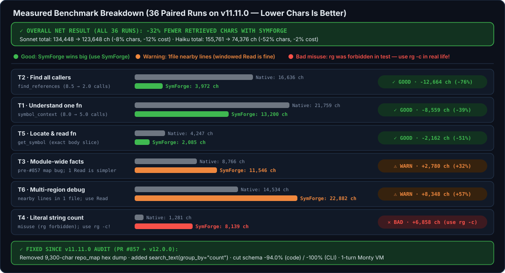
  </picture>
</p>

- **6-Language Polyglot & RTK Benchmark** ([`research/v12-polyglot-bench/`](./research/v12-polyglot-bench), 30 deterministic auto-graded tasks across `12,389` files in **Rust, C#, TypeScript, Python, Java, and Go** using exact `tiktoken` `o200k_base` counts): at **30/30 (100%)** oracle accuracy across 6 five-task sessions, `Native Raw` (`rg` + file read) consumes **500,024 tokens** (143 turns), `RTK 1.2.1` CLI consumes **305,798 tokens** (−38.8%, 63 turns; `rtk read -l aggressive` strips function bodies and omits AST caller chains), `SYMFORGE_SURFACE=full` consumes **208,032 tokens** (−58.4%, 48 turns, including **14,187 tokens**/session of 40-tool schema), **`SYMFORGE_SURFACE=code` consumes 26,166 tokens (−94.8% vs. Native, −91.4% vs. RTK, 36 turns, 880-token schema)**, and **`symforge code run` + `rtk git` hybrid consumes 15,498 tokens (−96.9% vs. Native, −94.9% vs. RTK, 36 turns)**. Includes Stage 2 smol-LLM multi-turn harness (`stage2_smol_agent.py`).
- **2026-11-09 Product Audit** ([`docs/reviews/2026-11-09-product-audit/AUDIT.md`](./docs/reviews/2026-11-09-product-audit/AUDIT.md), 36 paired runs across Sonnet and Haiku on 11.x): measured **17,300 tokens (`69,295 B`)** of upfront schema overhead on the 40-tool `full` surface (`66,181 B` / ~16.5k tokens in 12.0.0). SymForge retrieved **39–76% less content in up to 4× fewer calls** on caller/reference tracing and symbol lookup, but **32–535% more content** on literal counting and nearby single-file reads, yielding a confound-adjusted **2–12% net difference** on mixed read tasks with no round-trip reduction. Those findings directly drove V12's `code` surface (**3,980 B / ~995 tokens**, −94.0% schema overhead) and single-turn `code_execute` / `symforge q` chaining.
- **Earlier cohorts:** the 2026-10-05 five-pair 11.x cohort returned `NO_WIN` (−603,609 total tokens, −40,011 paired median where three of five pairs cost more); the 8.14.1 two-pair benchmark measured −24.8% tokens within a narrow scope.
- **Standing 5-arm benchmark** ([`research/token-benchmark/`](./research/token-benchmark), CI-tested): compares native tools, steered/unsteered `full` MCP, `SYMFORGE_SURFACE=code`, and zero-MCP `symforge-code` CLI skill across repositories with path-scoped rule confounds tracked. Live 5-arm V12 cohort runs have not yet been published, so no general V12 net percentage is claimed.

Details: [Benchmarks and Token Savings, What is recorded](https://github.com/special-place-ai-heaven/symforge/wiki/Benchmarks-and-Token-Savings#what-is-recorded) and [Where the evidence says it does not help](https://github.com/special-place-ai-heaven/symforge/wiki/Benchmarks-and-Token-Savings#where-the-evidence-says-it-does-not-help).

## Development

SymForge parses 19 languages with tree-sitter grammars plus 6 configuration and text formats with native parsers (25 `LanguageId`s). The toolchain is pinned in [`rust-toolchain.toml`](./rust-toolchain.toml) to **Rust 1.100.0** (edition 2024, `rustfmt`, `clippy`).

```bash
cargo fmt --all -- --check
cargo clippy --all-targets --all-features -- -D warnings
cargo test --lib --bins --tests -- --test-threads=1
cargo test --no-default-features --features embed --lib --tests -- --test-threads=1
cargo bench --bench observed_refresh_gate_v1 -- --test
cd npm && npm test
```

Do not combine `--all-targets` with `--test-threads=1` on `cargo test`; the Criterion benchmark target rejects that flag. Pull-request CI runs on Linux custom runners (`lint`, `conventional-commits`, `release-version` including version sync, V11 refreeze, `test_release_please.cjs`, and `research/token-benchmark` tests, `test-build` / `serial-suite`, `bench`, `release-build`, `embed-build`, `embed-musl`, `server-embed-parity`, `performance-smoke`, `advisories`, `npm`) plus sharded `windows-native` jobs on GitHub-hosted Windows runners. Releases on `main` are automated via Release Please.

Details: [Supported Languages, Language table](https://github.com/special-place-ai-heaven/symforge/wiki/Supported-Languages-and-Config-Formats#language-table), [Development, Test](https://github.com/special-place-ai-heaven/symforge/wiki/Development#test), [CI gates on pull requests](https://github.com/special-place-ai-heaven/symforge/wiki/Development#ci-gates-on-pull-requests), and [Releases](https://github.com/special-place-ai-heaven/symforge/wiki/Development#releases).

## License

SymForge is licensed under the [PolyForm Noncommercial License 1.0.0](./LICENSE).

> [!CAUTION]
> You may inspect, study, and use the source code for **noncommercial purposes**. Commercial use requires a separate license.
