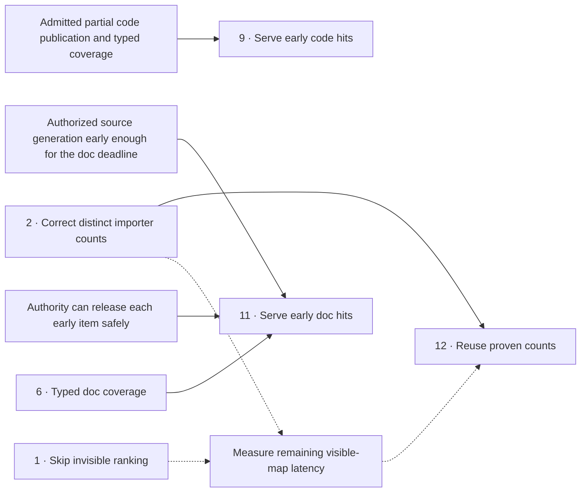

# Index speed implementation ledger

**Fix #1 removed the AAP timeout.** On an already published Agent_Army_Professionals (AAP) index, the CLI returned the same map bytes in 69 ms. The external embedded consumer returned its byte-identical baseline response in 8.5 ms on its first call. The 5,127-file moldwright root still shows key types and takes over eight seconds. Correctness and latency of visible ranking remain open under #2. [Client and embed measurements](#measured-results-for-fix-1)

## Dependency hierarchy

The numbers are stable proposal IDs. Following #1, pursue #6 and #4 so clients can distinguish loading from a genuine miss, and audit correctness in #2 before changing visible ranking. Start #7’s restore measurement alongside these and compare its measured opportunity with #3 before choosing the next latency PR. #5 can proceed independently on the existing admission path.

A solid arrow denotes a capability required by the proposed behavior. A dotted arrow denotes a result to measure before spending effort. Nodes without a number name prerequisite capabilities or measurements.

#3, #4, #5, #7 and #10 have independent entry points. #8 is retired as scoped. The bulk code publication currently precedes the doc bridge, so even instantaneous extraction cannot produce a 5 s doc hit on a run whose first usable source generation arrives at 8 s. #9 need not ship to satisfy the doc prerequisite if the complete source generation can arrive early enough. #5 can return an admitted project identity with the existing status; rich asynchronous progress requires #4. Verify the combined bind-to-hit flow when both ship.

## Work and proof

**Ready** means work can begin. **Blocked** means a named capability is missing. **Retired** closes only the stated proposal. **Measure** means the next action is a named measurement. **Conditional** means an earlier result determines whether the PR is worth doing. When updating a row, record its PR or commit and the evidence in the last column. Use **Verified** only after the real-client check succeeds. Use **Closed** with a receipt when the target already holds or the experiment fails its acceptance check.

| # | One PR | Requires | Evaluate after | State | Proof to record | Receipt |
|---:|---|---|---|---|---|---|
| 1 | Skip ranking when the budget cuts the whole key-type section | — | — | Verified at `d53e429f` | Decide from the directory prefix alone with the formatter’s UTF-8 byte and newline rules. Keep ranking if even the blank separator fits. Count eligible type tuples, including several in one file. Compare both footers and every byte at exactly 4,000 prefix bytes and one byte either side. Include 0, 1, 14, 15 and 16 tuples, a lone final type without a newline charge, annotated rows and a first overlong item. On SymForge and AAP clock dependent counting, sorting, total formatter time and client wall time before and after. Profile the residual if a hidden-section map still exceeds 2 s. | [d53e429f and client measurements](#measured-results-for-fix-1) |
| 2 | Audit and correct visible distinct-importer counts | — | — | Open. Root-module correction committed at `3c4628a0` | Audit the top 15 on SymForge depth 1 using file-level import and re-export evidence; check the OrderSnapshot fixture and watcher import. Build an independent expected set on a minimal Rust graph, including same-stem files, aliases, valid two-hop re-exports, qualified calls and unrelated imports. Fix only demonstrated wrong edges, verify dependent API and corrected map ordering, then remeasure SymForge and cetis.ceregister. | [Causal reproducer and remaining false edges](#visible-importer-audit-for-2) |
| 3 | Queue mandatory watcher reconciliation behind the first cold reload | — | — | Ready | During cold load create, edit, rename and delete files around watcher registration and force overflow. Time each disk mutation until the new symbol is queryable or the stale path disappears. Compare this interval and first-hit time with baseline. Require each pre-sweep read to match disk or report pending reconciliation, then disk-equivalent settled results. Reject any material edit-visibility or recovery regression. Only defer the sweep if contention after scouting is measured. | — |
| 4 | Expose phase, counters and retry guidance in status and loading replies | — | — | Ready | Drive two real code-mode stdio sessions, probing status while a search is held, through scout, parse, code publication and doc readiness. Verify project and attempt identity, unknown totals, empty roots, failure and cancellation. Check a real read as each phase claims readiness. | — |
| 5 | Bind an unbound local code-mode session to an approved repo | — | — | Ready | Launch from home without client roots. Bind, find known code and doc paths, and replay the bind with the same project identity. Try a disallowed root from a fresh session and verify it stays unbound. Check HTTP restrictions and session isolation, and the public code-mode contract (four names, exact list, 4,800-byte ceiling). Any change to that contract needs an explicit compatibility decision. | — |
| 6 | Return typed, generation-bound knowledge readiness and coverage | — | — | Ready | Capture partial hit, partial miss, complete miss, stale and withheld cases. Compare complete results with the baseline for hit IDs, spans, provenance, ranking and visibility. | — |
| 7 | Shorten snapshot restore to the first correct hit | — | — | Phase timings verified. Next investigate repeat source checks | On the same pinned root, clock snapshot read/decode, anchored per-file proof, and post-restore verification separately; also clock hydration, startup-to-hit and verified publication. Contrast strict stdio, local CLI and resident attach. Record actual attach/restore frequency before claiming prevalence. Choose the dominant safe improvement and preserve offline-change, corruption and quarantine outcomes. | [Strict stdio restore clocks and first correct hit](#snapshot-restore-to-first-hit-for-7) |
| 8 | Skip canonicalization of non-files to bring cold code under 3 s | — | — | Retired | The proposed micro-optimization has no isolated time saving large enough to justify this PR. A future scout investigation can directly time walking, canonicalization and entry probes. Reopen only with evidence of material end-to-hit benefit. | [Review decision](REPORT.md#independent-review-reconciliation) |
| 9 | Serve opt-in, early file-local symbol hits | Admitted partial generation and typed code coverage | — | Blocked | Decide feasibility now. Identify when the first admitted, hash-verified file can safely publish before the whole scout. Prove generation, coverage, an inconclusive early miss, a correct known symbol under 3 s on stdio and unchanged complete/cross-file answers. If this capability cannot be provided, report the residual openly. | [Cold clocks](REPORT.md#cold-phase-profiles-on-the-two-large-repositories) |
| 10 | Extract doc candidates in byte-bounded parallel batches | — | — | Measure | Confirm the deferred bridge is material on the chosen root. On both AAP and moldwright compare bridge time, first verified doc and code hits, and peak bytes. Establish baseline code-hit variation before the alternating runs. Reject a slowdown outside that variation on either root, even if docs hit 5 s. Require the same cards, links, limits, order and authority decisions. | — |
| 11 | Serve screened doc sections before the complete bridge publishes | #6, timely admitted source generation, per-item authority | — | Blocked | Capture every early response. Each early hit’s path, hash, span and rendered evidence bytes must match an authorized item in the complete serial evidence set for the same query and source generation. Exercise a candidate later withheld and require zero early disclosure. Check a verified hit under 5 s, an inconclusive partial miss and identical final ranked results. | — |
| 12 | Reuse exact importer counts across overlapping visible maps | 2 | Visible-map timing after 1 and 2 | Conditional | Measure map calls per immutable publication, their overlapping candidate paths and the frequency of reuse after the first call. Proceed only with meaningful overlap and residual latency. Compare first and repeated map bytes, time and memory; edit an out-of-scope importer, remove a re-export, switch roots and query across publication to catch stale counts. | — |

Preparing match strings once per target and shortlisting qualified calls with existing name postings remain possible performance follow-ups after the visible counts are correct. Measure that pass separately before proposing another PR. [Peer comparison](REPORT.md#projects-that-build-repository-maps-for-coding-agents)

For #6, the live code-mode query `search_knowledge(query="quokka_ledger_5be7d99", limit=2)` on the ready 1,767-file SymForge index returned zero hits and 44 withheld items. Its five keys were `rendered`, `hit_count`, `rendered_hit_count`, `overflow`, and `withheld_count`. An embedded match already carries a coverage label, but an empty `KnowledgeSearchResult.matches` has no match from which to read one. Probe an empty result on both surfaces and hold a publication change between claim acquisition and retrieval in the embed test. The coverage and publication identity in the reply must describe the same generation that was searched. [Embed search](../../../src/index_lifecycle/embedded.rs) · [Embed result type](../../../src/index_lifecycle/public_api.rs)

### Visible importer audit for #2

On the clean `d53e429f` checkout, code mode served the depth-one compact map from ready generation 37 with 1,765 files. The first two rows, `OrderSnapshot` and `ReconcileAction`, share the same source file and the same arrow of 487. The benchmark line offered as dependency evidence imports the watcher from SymForge's library. The fixture is read as sample text by compression tests. The two ranks represent one incorrect file-level count. The full 2,348-byte map has SHA-256 `a03a6e178a1ebb2af446420eae19223d656cd377c431f0eca20a8240aa7885f2`. Job `01a211abffdd73668db1aa0731e9593a` captured the map, dependent rows, project identity and code hits on both sides of the request. The concurrent build makes this run unsuitable for a latency comparison.

The public `find_dependents(limit=1000)` returned 384 reference rows in 100 files for the fixture. Code mode caps the result at 100 files and, by default, 10 lines per file. It also applies the normal admission checks. A public witness can disprove an arrow, but counting those rows cannot establish the total for a large target. Use an independently enumerated graph for exact counts, and record both source and target for every disputed edge. [Public limits and admission](../../../src/codemode/backend.rs)

**One keyword reproduced the watcher error.** An eight-file control contains an outer crate with a watcher, a vendored crate declaring `mod service`, and an unrelated `tests/fixtures/rust/service.rs`. The vendored root imports `Svc` from its own module. With `use service::Svc`, code mode incorrectly lists the vendored root as a dependent of the test fixture. Changing just that declaration to `pub use service::Svc` also makes the outer crate's watcher consumer a dependent of **both** service files. Its only import is `use crate::watcher::WatcherInfo;`. The correct fixture set is empty in both cases and the genuine vendored module has exactly one importing file. The real repository contains the corresponding module declaration and public re-exports. Replay `fix2-wire/vendor-seed-control.py <d53-binary> <label>` in the private evidence directory. Job `01a211b2de4b703da128633f72cdd898` captured both variants through stdio. [Vendored crate root](../../../vendor/rmcp/src/lib.rs)

All 15 displayed rows belong to seven physical files. Source inspection found the following distinct importing files. The six lower bounds include only verified import, re-export or qualified-use witnesses. Their upper bounds remain open.

| Target file | Displayed rows | Arrow on each row | Independently supported count |
|---|---:|---:|---:|
| `tests/fixtures/compression_ratio/rust/service.rs` | 2 | 487 | 0 |
| `src/sidecar/server.rs` | 1 | 479 | ≥7 |
| `src/server/mod.rs` | 1 | 479 | ≥15 |
| `src/stel/handler.rs` | 1 | 475 | ≥4 |
| `src/parsing/mod.rs` | 2 | 465 | ≥23 |
| `src/cli/mod.rs` | 5 | 465 | ≥9 |
| `src/git.rs` | 3 | 460 | ≥12 |

For example, the private `SidecarListenerKind` enum shares its file with the public function `spawn_sidecar`. The parent module re-exports that function and integration tests import it. Those are genuine file-level dependents. Private replay files `fix2-oracle/pinned-top15.csv` and `fix2-oracle/confirmed-groups.csv` identify the rows and witnesses. Source scan job `01a211b03753756c9199834e33bc8987`. [Sidecar re-export](../../../src/sidecar/mod.rs) · [Integration consumer](../../../tests/hook_root_guard.rs)

The positive out-of-tree control declares `#[path = "fixtures/rust/service.rs"] mod service;` in an integration test and imports `service::OrderSnapshot`. The baseline correctly returns that test for the fixture. Preserve it when correcting the false watcher relationship. Job `01a211b3fa0371ffbfa6486e6a97d2b2`. A second, compiler-checked graph distinguishes eight genuine importer files on the left from five on the right. At `d53e429f` the API returned five and four respectively, including false edges on both sides. Plain `self::` and `super::` imports work on the left. Alias, glob and re-export omissions must be measured independently from removing false positives. Rust compiler job `01a211a9c39e77c6a3dc25c6611cacec`; stdio job `01a211b30bf3720da9026af47b38b00a`.

The correction to the re-export seed keeps the existing matcher for ambiguous inputs. It can reject a candidate outside the usual `src` layout when a parsed crate root declares a conventional same-named module, that module has one indexed sibling file, and the fixture supplies no evidence for the imported name. Across the six public/private, path-attribute and redirected-sibling controls, the candidate removed exactly the false fixture edges predicted by the experiment. The previously correct file references and the real vendored target's returned evidence were preserved. That latter result includes a pre-existing false transitive edge. A direct `inner_fixture::service::Svc` import in the private-import control still produces a false fixture edge. Jobs `01a211d19a9573efa7b517b2e5c73144`, `01a211d1a36a75f3b7c4543047acfd4d`, `01a211d1aba2779aade4e85e94caec64`. The before/after assertions ran in `01a211d204c6745c9c64b0f518a2b6f2`.

On the same 1,765-file input, the scoped map changed **487 → 56** for both fixture types. At depth one, `ResolvedTreeReference` and `CodeModeLimits` took the last two visible rows. The other 13 retained their order and counts. The new Git row uses the already-audited `src/git.rs` file. For the newly visible `src/codemode/mod.rs`, direct imports of `CodeModeLimits` appear in `src/cli/code.rs`, `src/codemode/runner.rs`, `src/protocol/code_mode_tools.rs` and `tests/codemode_sandbox.rs`. These establish four witnesses for its displayed 460. The public dependent API now returns 63 reference rows across 56 paths, below its file cap. The first four paths import from the external `rmcp::service` module. The other 52 are under `vendor/rmcp`. The source-supported fixture count is zero. The arrow of 56 still fails the correctness gate.

**Visible map cost.** Each cell is the median of three code-mode stdio calls on the same checkout and binary for that cell. Both orders on Cetis produced identical map bytes. The candidate was slower in both orders on this zero-Rust control. The block medians also moved by about 1.5 s between orders, so these runs establish neither a cause nor performance parity.

| Depth-one compact map | Baseline `d53e429f` | Candidate `3c4628a0` |
|---|---:|---:|
| SymForge, baseline first | 35.663 s | 36.055 s |
| Moldwright, baseline first | 9.221 s | 9.110 s |
| cetis.ceregister, baseline first | 9.888 s | 10.337 s |
| cetis.ceregister, candidate first | 8.371 s | 8.605 s |

The external embed-only Rust consumer reproduced the code-mode body for both the hidden and visible SymForge controls on each revision, with the full response suffix and retrieval handle checked separately. On 5,127-file Moldwright the candidate's 2,168-byte visible body matched code mode (SHA-256 `6187a306c911f08d9d0335573dc3bdfa99d97a3bbd90872357f81fb589392d0a`). The full embedded response was 2,396 bytes including the 228-byte suffix. The first and repeat embedded calls took 7.812 and 7.917 s. Both exceed the 2 s map target. Embed comparison jobs `01a211eede4c7559b15bf88ea3478a2e` and `01a211f8dd8777feb97c70e746b3d504`. Reverse-order Cetis jobs `01a211fab1ab77b69fb6f068b40be477` and `01a211fb6604778f9942c3a1d5134ca4`.

**Native and public regression results.** Five existing `find_dependents_pass2` integration tests passed on the candidate (job `01a212017e6270a39a8acf862bc03138`). Two attempts to build the full library test binary exhausted memory before it ran. A small integration target compiled the three committed regression test bodies verbatim against the candidate, using public parsing and in-memory index construction. Two passed. The module-identity test failed its positive assertion requiring the crate root among the real module’s dependents (job `01a212141f1f715ba18ca21a23455613`, exit 101). Retain that assertion.

The public code-mode replay isolated the failure across eight paired cases on the two protected binaries. It varied `lib.rs` versus `main.rs`, public versus private import, and flat `service.rs` versus directory-backed `service/mod.rs`. Both binaries returned the genuine root edge in all four flat cases and missed it in all four directory cases. The candidate removed false fixture edges in all eight. This establishes an existing directory-module false negative alongside the real false-positive correction. Fix the missing genuine edge and keep all eight pairs as the next #2 gate. Job `01a21215e7d67065a9cf99628c8dca49` completed 16 ready-index stdio queries on the six-file fixtures.

| Remaining #2 work | Prerequisite | Proof before closing |
|---|---|---|
| Resolve direct same-stem imports to their source module or crate | Independent real source witnesses and the pinned two-crate controls | Remove all 56 unrelated fixture paths. Preserve genuine out-of-tree bindings, plain relative imports, external crate names, and dependencies on the real service module. |
| Capture grouped aliases, standalone renamed imports and globs | Parser-level red cases taken from the compiler-checked graph | Preserve each imported name and origin, including a rename inside a group. If stored reference data changes, verify restored old snapshots and cold-built views converge. |
| Carry the re-exported name and origin across two hops | Direct identities and parsed binding evidence | A consumer of the right-hand name through a shared re-exporter must stay outside the left-hand file set. Require the exact 8/5 sets on the pinned graph and real-client parity. |
| Re-evaluate #12 | Correct counts, independent checks for newly visible rows, measured repeat overlap | Compare first and repeated calls on a single immutable publication. Hold caching while the known false edges remain. |

### Snapshot restore to first hit for #7

On pinned Moldwright `3d172845`, a no-daemon code-mode client started from an existing 45,891,856-byte local snapshot. The first request received a loading refusal after 25.004 s. At 50.233 s from launch the retry returned `main` in `apps/engine/src/cli/bin.ts`. The pinned source defines `async function main()` at line 53. The same result list contained a manifest key also named `main`. The session reported the expected root, 5,127 files, `Ready` and `snapshot_restore`. Job `01a211c5a37073249637d110d1206ba9` exited 0. This was a diagnostic build of #1. File opening and verification timings include the Windows host's I/O conditions for this run.

| Stage in the successful process | Elapsed |
|---|---:|
| Launch through snapshot read/decode and entry to the anchored source proof | ≤0.94 s |
| Anchored proof of 5,127/5,127 files | 32.458 s |
| Rebuild file map, trigrams, reverse index and path index | 0.146 s combined |
| Background source comparison, zero changes, deletes, additions or spot mismatches | 15.709 s |
| Publish the verification result | 0.282 s |
| Full active background verification, including publication | 15.991 s |

Read/decode finished before the anchored proof. The proof-complete log arrived 33.396 s after launch, so subtracting its 32.458 s duration bounds all work preceding the proof. The first probe instrumented the portable artifact decoder; the successful local restore reads `.symforge/index.bin` through a different function. Reducing the first proof and the later source comparison offers a larger measured opportunity than optimizing decode. A replacement must still detect edits during restore, preserve offline-change and corruption handling, and return evidence from the verified generation. [Local restore and verification](../../../src/live_index/persist.rs)

Five fresh standalone processes then read the identical snapshot (SHA-256 `ed386b2201c225778b0331215279b9bcdbb54842c207b3937acd0080ab8139d6`), verified the payload checksum and deserialized a version-11 index with 5,127 files. Median file read was **14.1 ms** (12.8–24.0 ms). Median checksum plus decode was **127.1 ms** (125.6–128.7 ms), including median SHA-256 time of 10.5 ms and postcard deserialization time of 116.6 ms. The probe linked the release library from `799b8007`. Its snapshot implementation, hash implementation and dependency lockfile match `d53e429f`. Earlier reads had likely warmed the Windows file cache. The 0.94 s bound above remains the measurement from the actual stdio launch. Job `01a21205898272ea9c0102fc742c394f`.

An isolated CLI comparison used the same snapshot and confirmed the daemon PID, root, `SnapshotRestore` and 5,127-file load. After 22 loading replies the client first returned the exact `main` function at 50.188 s from launch. A new CLI process attached to the same resident daemon and returned the same evidence in 76 ms wall time (40 ms internal). This run overlapped a native test build; it demonstrates the difference between a restore and an attested resident attach. Population-level attach frequency remains unknown. Job `01a211efa6c67629b4dbf7d4b2050a1b`.

## Fix #1 controls and timeout replay

A standalone probe used the budget helper and both truncation footers from Git revision `3a4fb63d`. It exercised prefix costs from 3,930 through 4,020 UTF-8 bytes, one- and two-row layouts, multibyte text, scoped and unscoped footers, and 0, 1, 14, 15 and 16 type tuples. In **2,730 comparisons**, replacing an entirely hidden section with the same number of placeholder rows exercised 504 skips and changed zero rendered bytes. A deliberately premature cutoff at 3,999 bytes changed 24 responses. Replay on the benchmark host with `uv run --no-project python map-prefix-risk-control.py` from the report’s private replay directory. Terminal Commander job `job_01a20d71085c7799b8b7812ced0747fb` exited 0. The probe supplies the rows directly. Candidate discovery, ranking, and transport still need product-level proof.

1. **Prove the intended work disappeared.** On the pinned SymForge and AAP roots, explicitly request the unscoped compact map with default depth. Record the footer, full rendered digest, eligible type count and number of dependent lookups. Require eligible types and positive lookups on the baseline, identical rendered bytes and zero lookups on the candidate. Also run a scope with a visible annotated type, require a positive lookup count on both versions and compare its complete bytes. Keep diagnostic counters out of the timed release binaries.
2. **Replay the original failure.** Give each matched binary its own daemon and verify client and daemon identities. On an already ready AAP publication, bracket the same default compact-map request with known code hits over persistent stdio. Keep the original transport deadline. Record the first and repeated call wall times, map bytes or exact error, and the surrounding hits. A timeout counts as a failed attempt. Wait for the server-side operation to finish or use a fresh isolated daemon before the next sample so an expired request cannot consume the next run’s worker time.
3. **Locate any remaining delay.** If a hidden-section request still takes 2 s or more with zero lookups, capture the time from request admission to formatter entry, inside the formatter, and from formatter exit to client receipt. Compare with the no-daemon path on the same source tree. Use the longest measured interval to scope the follow-up. Keep the latency target open even if byte equivalence passes.

### Measured results for fix #1

The candidate at `d53e429f` counts the UTF-8 prefix up to and including each directory row's newline. When the separator cannot fit, it skips the dependent lookups and sort. The existing renderer still writes the footer. When the separator fits, it ranks the same candidates as before.

| Surface and pinned input | Baseline | Candidate | Evidence |
|---|---:|---:|---|
| AAP CLI, private daemon | Packaged binary timed out after 60.076 s | 69 ms wall, 27 ms internal | Known code hits before and after. Rendered SHA-256 matches the completed 111 s baseline on the same pinned input. Jobs `01a20d826bdc724790ca6251602242d4` and `01a20d9a7cb57539ba366b863deb20a2`. |
| AAP persistent code mode | Matched-profile run stopped after 141 s without a map | First 11 ms. Across 20 calls, median 10 ms and maximum 14 ms | Visible scoped control retained its annotated type, median 161 ms and maximum 176 ms. Job `01a20d9e1bad768193e8c19b7c0eb0fa`. |
| SymForge persistent code mode | 34.730 s first root map | 3–4 ms across 21 root maps | Every candidate digest matched the completed baseline. Visible fixture median 246 ms before and 264 ms after in separate runs. Job `01a20da09842719bb1ba79ed1a1a731e`. |
| moldwright persistent code mode, 5,127 files, visible root ranking | 10.258 s and 8.684 s | 8.556 s and 8.345 s | All four maps on the same physical checkout had identical rendered bytes. Scoped control took 309 and 312 ms. Jobs `01a20dab798c76828c45fcc7a1893c76` and `01a20dac6a7572dfa2da43944818bee7`. The root misses the 2 s target. |

The optimized baseline and candidate used matching settings, with LTO disabled and eight codegen units. Building the stock LTO profile exhausted memory on this host. The packaged CLI timeout is a distinct observation. Private replay scripts are `daemon-deadline.py`, `stdio-map-replay.py` and `boundary-release-compare.py` in the report's replay directory.

A further **90 maps across 20 code-mode cases** passed an independent replay audit. The first ready-root calls from five fresh clients took 7–9 ms on AAP and 4–5 ms on SymForge. On AAP an additional 21-call series took 8 ms first, 8 ms median and 12 ms maximum. On held-out terminal-commander the default took 3,204 ms before and 2 ms after, with a 3 ms maximum over 20 further candidate calls. Its visible `crates/probes` scope took 275 and 320 ms. The SymForge visible control in baseline/candidate/candidate/baseline order took 293/301/269/322 ms. Each compared root/scope had identical rendered bytes throughout, a ready project receipt and a verified code hit after the map. A missing fixture path in the first batch was caught by its assertion. The remaining six cases used the verified `EventSink` scope. Collection jobs `01a20e170fb6733191654e6e753d4a83` and `01a20e19489e73e78123a1f536aa59c5`. Replay `check-stdio-matrix.py stdio-batch-20261124-160523` in the private replay directory. Audit job `01a20e1b69907213969b0922c333a1df` exited 0.

The public formatter matched the packaged binary on ten fixtures covering Unicode, near-budget prefixes, multiple types in one file and the 15-type ellipsis. The candidate's counted boundary test observed 80 lookups at 3,999 bytes and zero at 4,000. The pre-fix negative control still made 80 at 4,000. The boundary test and the four existing compact-ranking checks passed under jobs `01a20dadb682702a8fbcbdb18c098fc1` and `01a20dbc349070a3b2edb36f1bc0228e`. The external consumer measurements appear below.

A private instrumented build rendered each root twice against the same immutable publication. One pass forced the original ranking, the other used #1. Each pair was checked for exact byte equality. These clocks isolate work inside the formatter. The uninstrumented client observations above measure user-visible latency.

| Root | Dependent lookups, original → #1 | Dependent counting, original → #1 | Sorting, original → #1 | Entire formatter, original → #1 |
|---|---:|---:|---:|---:|
| SymForge, 1,765 files | 335 → 0 | 37.5882 s → 0 | 1.356 ms → 0 | 37.5928 s → 3.306 ms |
| AAP, 4,345 files | 899 → 0 | 107.7287 s → 0 | 3.428 ms → 0 | 107.7378 s → 5.441 ms |
| moldwright, 5,127 files | 430 → 430 | 9.3961 s → 9.4651 s | 0.552 ms → 0.379 ms | 9.4015 s → 9.4702 s |

The visible controls agreed byte for byte. SymForge's `tests/fixtures/compression_ratio/rust` and AAP's `07_app/crates/aap-core/src/identity.rs` each showed two annotated rows and made one lookup in each mode. Moldwright's `apps/engine/src/agents` showed six annotated rows and made five lookups in each mode. The three complete default outputs were 4,234, 4,194 and 3,728 bytes respectively. The fresh diagnostic generations all reported temporal state Pending with zero file histories. They establish within-generation equality, but cannot attribute the separately observed ordering of tied names to churn. Build job `01a20e40e94070268775b75982642093`. Run jobs in table order `01a20e4accc87318b0b2c90289a0365a`, `01a20e4be55b721e9680ef88b7f57641` and `01a20e4e11957017b5f3fee8e38f59b1`.

## When an outcome is complete

| Outcome | Acceptance on the real client |
|---|---|
| Warm map | On the frozen 5,000-file workloads, every measured warm compact map returns in under 2 s with zero timeouts. #1 must return identical bytes at the same generation. Apply the same under-2-s limit to the first map on an already published view and the repeated warm maps. On each large root include an explicit scope with at least one visible type row. Record any intended ranking correction from #2 against its independent oracle. |
| Cold code and docs | Drive a roots-bound code-mode stdio client from initialize, and record CLI timing separately. Time from project open to a known code hit under 3 s and doc hit under 5 s. If using the partial-answer path, capture the useful evidence and truthful coverage the client receives by each deadline, then verify the eventual complete answer. |
| Progress | A waiting client sees the correct phase, counts and retry guidance through completion or failure. Record what the client saw and which reads actually worked. |
| Unbound session | One roots-less session binds an approved repository and finds independently verified code and doc hits. Repeating the operation preserves the project identity. |

### Model context

Measure context savings on a concrete question that a model can answer from a smaller response. For example, to establish how a scoped map groups paths, the candidate's real MCP `get_symbol` returned `map_dir_key` from lines 401–417 of `src/index_lifecycle/guidance/read_context.rs` at `3a4fb63d`. The returned source matched the Git bytes. With `o200k_base`, the entire JSON-RPC response took **538 tokens** and the raw full file took **12,714**, a saving of **12,176 tokens (95.8%)** for that lookup. This measures targeted retrieval. Fix #1 preserves map bytes, so its measured benefit is latency. Terminal Commander job `job_01a20dbc92607426bec4105ee11cc18c`.

### Embedded consumers

For each change that reaches the embedded engine, run both persistent MCP and a Rust consumer linked with `default-features = false, features = ["embed"]`. Confirm the resolved dependency features. Use the consumer's public source handle, on the same pinned inputs, with the same deadlines for useful results. Report each surface separately. Process startup, admission and cache hits can otherwise hide the time taken by the actual query. [Public consumer example](../../../examples/embed_query.rs)

On pinned SymForge the external consumer's first map took **38.520 s before and 3.150 ms after**. The second baseline call took 37.746 s. All 20 candidate repeats completed. Both builds returned the same default, scoped and capped responses (4,462, 556 and 606 bytes). Resolving each saved handle reproduced the complete map and its publication metadata. The shared bodies also matched code mode, byte for byte, for the default (4,234 bytes) and visible scope (328 bytes). A known symbol and its source span remained readable on both sides of the map calls. Opening time is excluded. Jobs `01a20dd90b1774039c8abb32d6b5e356` and `01a20ddbc25a77048f3bbf0f6d6df418`. Replay the byte comparisons using `embed-consumer/compare-outputs.py` in the private replay directory.

On AAP the external consumer's first default map fell from **101.988 s to 8.504 ms**. The next baseline call took 100.593 s. The candidate's 20 repeat calls had a median of 6.476 ms and a maximum of 22.019 ms. The visible scoped control had repeat medians of 176.549 ms before and 181.255 ms after. The first scoped calls took 154.337 and 235.269 ms respectively. The full default, visible and capped replies matched at 4,422, 528 and 566 bytes. Both builds' retrieved handles reproduced the full map. The common bodies matched code mode for the default (4,194 bytes) and visible scope (300 bytes). Jobs `01a20ddc69cf736c83cb0e47c22fd6dd` and `01a20de2089a74bba84d981bdc99cee8`.

On moldwright both external builds returned identical full default (3,956 bytes), scoped (1,123 bytes), and capped (576 bytes) results and reproduced their complete default payloads from handles. The visible default took **8.956 s before and 8.436 s after**. The 20 candidate repeats had a median of **8.311 s** and maximum of **10.187 s**. Among the 58 lines in the embedded body and the earlier independent MCP root capture, the only difference was the relative order of `ApiError` and `Window`, both annotated with 292 importers. The two embedded builds agreed on the order. Jobs `01a20de366627500a9078dccfd2379dd` and `01a20de5239d73488e9b9fd0c912e853`.

| Change | Embedded proof |
|---|---|
| Map generation and ranking (#1, #2, #12) | Time the first `QueryRequest::RepoMap` on a current publication and repeated calls. Retrieve the full result and compare rendered bytes and metadata against the previous embedded binary. Also exercise a capped request and its truncation receipt. Check a visible scoped map and the default root. |
| Discovery, restore, and code or document publication (#3, #6–#11 where applicable) | Start the clock before `open_embedded_source`. Use `SymbolSearch` and `SearchKnowledge` for distinct independently known hits. Record publication identity, coverage, refusals and first complete results. Check source edits and reopened snapshots through the same public handle lifecycle. |
| Progress and root selection (#4, #5) | Observe the host's `runtime_view()` while opening an explicitly selected source. Check which operations actually succeed at each reported phase and that selecting a second source preserves isolation. Measure stdio binding separately, since the embedder already supplies its root. |

### Read routing and embedded counts

**Related evidence-selection experiment, 25 November.** Choosing the right helper can reduce recovery. On a 14-symbol development pool, relevance-first and facility location both retained all six scored facts across two questions at their primary budgets. Role coverage lost the checkpoint guard. Next compare automatic bounded discovery and one batched support read against an effective code-mode caller and a direct read on held-out tasks. Retain the small-file bypass, check absolute source ranges, and use #2 as a prerequisite for trusting wider import edges. This experiment changes no default and adds no dependency to the numbered index fixes. [Selection trial and dependency priorities](EVIDENCE-PACKING.md)

The `feat/map-read-cost` branch at `799b8007` builds the explicit routing view on top of #1. The held-out comparison keeps compact as the default. Explicit routing can help with a named symbol on a large file. The complete seven-scope experiment and the direct-read counterexamples are in the [research report](REPORT.md#routing-trial-on-held-out-checkouts).

The final optimized server (SHA-256 `c9dafeb1a21b57721ffdd859312137336ae339418970421ca8a86c6fcb587c5b`) served the same one-file fixture over both public stdio surfaces. The full tool surface returned a routing map and a default compact response byte-identical to the preceding #1 binary (SHA-256 `c089cbd3d7effbda672588464d08c14747987732cb58ce136956757793447868`). On code mode, discovery advertised routing, the scoped call counted one admitted file, and the numeric missing path counted zero. The replay sets `SYMFORGE_SURFACE=full` explicitly for the classic tool, because an unset surface selected code mode in this environment. Build job `01a20e75afc7768a94f950ef7f143562`, wire job `01a20e7c59e8728aaf69b03dbadbac18`.

A separately built Rust client using only the `embed` feature returned the exact same routing bytes as code mode on moldwright `apps/ui` (4,147 bytes, 1,957 of 2,441 admitted files shown) and terminal-commander root (4,201 bytes, 946 of 1,039 shown). On a controlled fixture the public client checked all three voting categories, a capped response representing one file with three symbols, retrieval of the complete uncapped map, and a missing scope containing the literal text `42 files`, which correctly returned zero shown and zero admitted. The 186-byte direct-read source body also matched disk exactly. Job `01a20e34f5e0700cbecae4442e125a4e`.

At production revision `bf3eb050` (followed only by the fixture correction at `799b8007`), all **seven** held-out routing calls reproduced their accepted rendered bytes, admitted file count and shown file count through real code-mode stdio. The same executable reproduced both saved compact controls and matched the complete external embed routing payloads on moldwright `apps/ui` and terminal-commander root. The first private replay stopped on an incorrect path to the archived embed result. After correcting the path, all nine comparisons passed, with raw wire receipts under `final-feature-wire-20261124-165635`. Job `01a20e7cdec972929ecb50307a8c1cd1`, exit 0. This replay checks output equivalence so the original held-out token accounting applies to these bytes.

The final focused native checks passed at feature tip `799b8007`. The code-mode and classic argument contracts each ran one test (jobs `01a20e6e881d727f975d85694cbe922f` and `01a20e7dbadb727d8819fc5511b05ea9`). The public embed-only integration target ran both tests, covering compact, full, tree, routing, caps, project scope and file context (job `01a20e83473072059db39d0d8559a871`). The conservative voting and 3,999/4,000-byte boundary unit tests also passed (jobs `01a20e83ba1b7708a69ea0e7379081b8` and `01a20e89479877169f59344bd3ce7ef0`). Formatting and diff checks passed. During verification the strict server build caught unused embed-only metadata, and the embed test caught a two-file expectation after its fixture gained a third file. The final runs include both corrections.

An existing compact-mode metadata discrepancy remains a separate correctness item. On moldwright `apps/ui` the embedded compact result reported 5,127 total and zero shown while its text described 2,441 files. On terminal-commander root it reported 1,039 total and zero shown. The common compact text matched code mode on both, and embed added its existing 228-byte doctrine suffix. A separate PR should establish and fix the meaning of compact `total_files` and `shown_files` under path, renderer and public query limits, with an explicit compatibility decision for integrations. The new routing view derives those counts from admitted files and complete emitted rows.

Use the pinned revisions, inputs and replay commands in the report. Alternate baseline and one candidate, run at least five fresh starts and twenty warm calls per shape, include failures, and check a held-out repository. Record the binary, root, generation, load source, result fingerprint, wall time and Terminal Commander receipt. Stop a branch of the hierarchy once its outcome holds and its functionality checks pass. [Real-client acceptance protocol](REPORT.md#acceptance-on-the-real-client)

## 25 November campaign results (merged to main)

Recorded by the session that took the campaign over on 25 November. Each row is a squash-merged pull request with green CI and a pre-merge review. Timings were taken on the same Windows host as the rest of this ledger, interleaved against the previous build with a matched build profile (opt-level 3, 8 codegen units, no LTO); the host was under memory pressure with other builds running, so single calls vary and medians are quoted.

| PR | Change | Measured before | Measured after | How measured |
|---|---|---|---|---|
| #945 | Fix #1: skip ranking when the compact map hides every key type | See [fix #1 results](#measured-results-for-fix-1) | | |
| #946 | Count key-type importers on the bounded query pool (`ordered_parallel_map`) | Depth-one compact map median 9.2 s on Moldwright (5,127 files), 35.7 s on SymForge (1,765 files) | 1.25 s and 3.75 s, identical rendered bytes | `stdio-map-replay.py`, 3 calls per run, base/cand/cand/base |
| #952 | Importer matchers (`matches_target_stem`, `matches_target_module`) no longer allocate per reference | 0.59 s and 2.4 s on top of #946 | 0.15 s and 0.50 s; importer counts identical on every row | Same harness; old and new matchers compared on 21,138,600 real checks with 0 mismatches |
| #947 | Snapshot restore proves files in parallel; the stat pass and spot check run in parallel chunks. Every file is still read and hashed | Launch to first correct stdio hit 62.6 s and 34.5 s on the 5,127-file Moldwright snapshot | 13.4 s and 11.3 s, first attempt, no loading refusal | `fix7-clocks/restore_measure.py`, base/cand/cand/base |
| #949 | `code_execute` returns lean text by default (tables grouped by path, raw source); `SYMFORGE_CODE_OUTPUT=json` restores the JSON text | 1,318 / 921 / 560 o200k_base tokens for 20 symbol hits / 16 reference rows / a 49-line function | 436 / 448 / 463; the 24-token wrapper per call is gone | tiktoken on real replies |
| #951 | `context=N` on `find_references` and `search_text`; unknown-keyword refusal carries the signature; lean record lines omit null fields | Two round trips to see the code around a call site | One | Contract tests; `context=0` rows byte-identical |
| #950, #953 | Hooks speak only when the text pays for itself: no output without an identifier-shaped or backticked cue, none for windowed or small reads, one line after a large whole-file read, none for task notifications or prompts over 2,000 characters; the assumed windowed-read savings figure is removed | About 300 tokens after each windowed read, a line on every prompt, false hints for ordinary words | 0, 0, and about 40 tokens only after a whole-file read of 8,000 bytes or more | Session transcript audit, then handler tests |

Phase clocks of the restored index after #947, one run on a busy host: 5,127 files read and hashed in 5.17 s; stat pass 2.63 s; new-file discovery 2.73 s; spot check of 570 files 0.39 s; verification publication 0.53 s; first hit at 14.4 s. The second pass re-observes, about a second later, files the first pass has just proven by full hash. That is the next restore opportunity under #7 and it needs a decision about what detects an edit between the two passes.

### Read-cost gradient after lean replies

Token cost (o200k_base, request plus reply) of fetching a file's main symbol through Code Mode against reading the whole file, on Moldwright TypeScript files:

| File size | Direct read | Code Mode, JSON text | Code Mode, lean text |
|---:|---:|---:|---:|
| 400 B | 121 | 183 | 141 |
| 999 B | 267 | 329 | 266 |
| 3,007 B | 646 | 569 | 438 |
| 12,053 B | 2,866 | 2,650 | 2,256 |

The small-file penalty that motivated `repo_map(detail="routing")` fell from about 60 tokens to about 20 at 400 bytes and to zero at 1 KB. The routing view on `feat/map-read-cost` therefore stays unmerged: per-directory hints in every map would cost more than they can save, and an opt-in view was ruled out by the owner on the same day ("ONLY INTERESTED in NET win"; features that are off by default do not count).

### Still open, found on 25 November

- Equal-count rows in the compact map are ordered by git churn, which reads as 0 until git history statistics have loaded, so the order of tied rows depends on when the map is requested. The counts do not change.
- For an importer reached through a re-export, `find_dependents_for_file` reports a reference row that depends on hash-map iteration order. The set of importing files is stable; the row lists are not repeatable run to run.
- #2 is unchanged: the directory-module edge is still missed and the 56 false fixture importers remain.
- Every change under `src/` must refresh its line in `tests/darkness_baseline/full_source.pins`; #945 went red on exactly this after local verification had passed.
- The host showed 48.1 GB committed of a 51.4 GB limit with about 20 GB in kernel pools. Optimized builds only completed at `-j 1`; treat allocation failures in builds on that host as environmental until it has been rebooted.

| #954 | `code_execute` decides inline-or-spill on the lean text it sends, and the default inline limit is 32,000 characters (was 16,000) | A 1,000-row list (about 10K as lean text) and three functions of 340 to 382 lines (16.4K to 17.6K characters) each came back as a truncated preview plus a spill file | All four return inline in one call | Sandbox and MCP surface tests; sizes from a throwaway measurement test |

The row above belongs to the 25 November results table; it merged after the table was written.

## 26 November results (merged to main)

Measured on the same Windows host after a reboot (23.5 GB committed of 51.4 GB), matched optimized builds (opt-level 3, 8 codegen units, no LTO), runs interleaved, against the Moldwright checkout: 5,194 indexed files, 34 MB, and an ignored `node_modules` tree of 1.2 million entries. Harness: `fix7-clocks/restore_measure.py` with `SYMFORGE_CODE_OUTPUT=json` added to its environment, because `code_execute` returns lean text since #949.

| PR | Change | Before | After |
|---|---|---|---|
| #955 | The post-restore check no longer walks ignored directories, lists each directory level in parallel, and reuses the size and mtime its walk already read instead of a second lookup per file | First correct stdio answer 169.7 s on the 7th attempt after 6 loading refusals; four other runs gave no answer inside 120 s. New-file walk 156.0 s, ending in "admitted source discovery exceeds its file bound". Stat pass 3.70 s. Whole verification 161.1 s | First correct answer 10.5 to 11.8 s on the first attempt. Walk 0.93 to 0.97 s and it completes. Stat pass 0.21 s (423 individual lookups, 4,771 taken from the walk). Whole verification 2.7 s |
| #957 | The restore proof proves files in path order and opens each parent directory once per run of up to 32 files, instead of re-checking every ancestor from the root for every file. Every file is still read and hashed | Read and hash 5.56 to 8.78 s; first correct answer 9.56 to 13.59 s | Read and hash 2.73 to 2.93 s in five of six runs; first correct answer 6.91 to 7.51 s in five of six runs |
| #956 | CI only: the `embed-musl` job builds the musl 1.2.6 compiler wrapper from the official source with a pinned SHA-256, after the prebuilt download site's TLS certificate expired on 26 November | Job failed before compiling on every run | Job passes in under 3 minutes |

What the measurements showed:

- The 25 November figure of 2.73 s for the new-file walk on this repo was not reproduced on 26 November, when the same walk on main took 156 s and failed at its 200,000-entry bound. The reason for the fast figure on the 25th was not established. Treat the 25 November restore totals (13.4 s and 11.3 s) as not representative of a repo with a large ignored tree.
- The cost of the restore proof is file opens, not reading or hashing. A plain serial open, read and SHA-256 of 5,078 files spent 2.8 to 5.2 s opening, 0.13 to 0.19 s reading and about 0.2 s hashing. In an isolated reader over 5,609 files the per-file route took a median 5.44 s, the grouped route 1.85 s, and plain unguarded reads 1.26 s.
- Grouping by directory only pays when a batch shares directories. The snapshot map iterates in hash order; before the entries were sorted by path the grouped reader gave 3.72 to 4.34 s live, after sorting 2.16 to 3.07 s.
- A first shape that opened all of a batch's directories up front could hold 256 directory handles at once, enough to reach the macOS default open-file limit. The merged shape holds one directory per worker. A group limit of 8 instead of 32 measured no faster.

Phase clocks on main after #957, one typical run: files read and hashed 2.8 s, new-file walk 0.87 s, stat pass 0.22 s, spot check 0.5 s, verification publication 0.3 s, first answer 7.0 s.

### Still open after 26 November

- The read-and-hash phase is still the largest part of launch. The remaining floor is one open per file, about 0.5 ms each on this host. Going below it means not opening every file, which is a decision about what the restore proof promises and belongs to the owner.
- The spot check re-reads 10% of files the proof hashed in full seconds earlier, about 0.5 s.
- A repo with more than 200,000 entries that are not ignored still fails the new-file walk at its bound.
- The items listed under "Still open, found on 25 November" are unchanged, except that the restore second pass is done.
