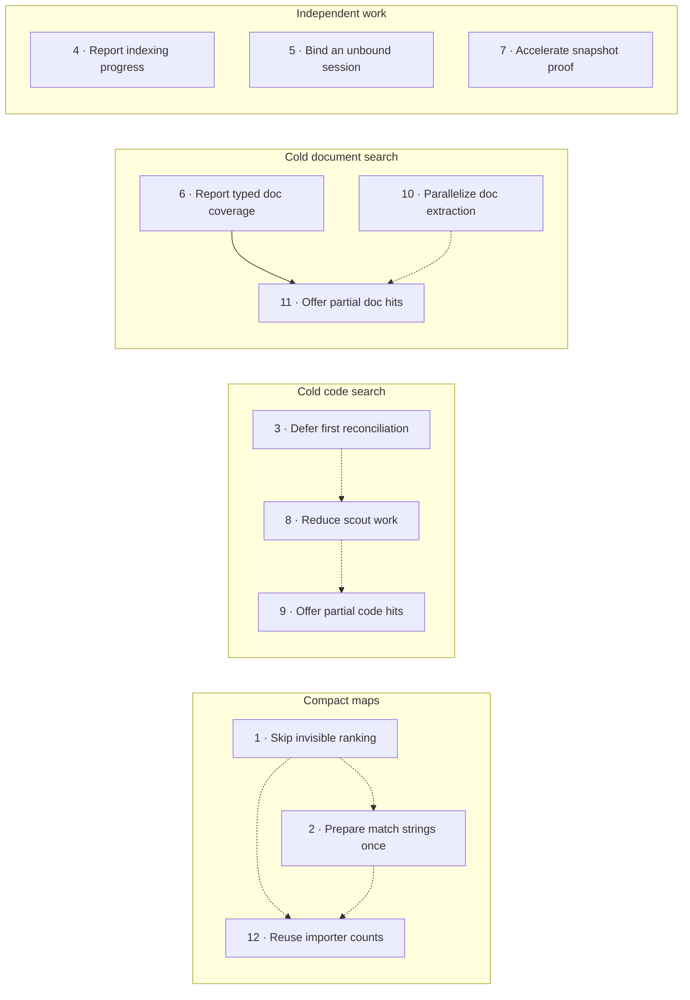

# Index speed implementation ledger

**Start with #1, the compact-map fix.** On the pinned SymForge and Agent_Army_Professionals (AAP) roots, the compact map discarded every key-type line after ranking it. The baseline includes the exact rendered-map hashes and the reproduced 60.09 s AAP daemon failure. The first PR can therefore demonstrate both a speed change and byte-for-byte preservation. [Research report and baseline](REPORT.md#why-compact-maps-cost-seconds)

## Dependency hierarchy

The numbers are the report’s PR ranks. A **solid arrow** means the downstream fix needs an upstream capability. A **dotted arrow** means to measure the result of the earlier experiment before deciding whether to proceed. A rejected experiment also settles that decision when its evidence is recorded.

Progress (#4) and binding (#5) can ship separately. Once both land, drive a single home-launched session through bind, progress, a code hit and a doc hit. Doc extraction (#10) can ship with the current result format. Early doc hits (#11) need the generation-bound coverage contract from #6 so an LLM can distinguish an incomplete miss from a complete one. Snapshot restore (#7) has its own clock and can be investigated independently of fresh indexing.

## Work and proof

**Ready** means work can begin. **Measure** means the next action is a named measurement. **Conditional** means an earlier result determines whether the PR is worth doing. When updating a row, record its PR or commit and the evidence in the last column. Use **Verified** only after the real-client check succeeds. Use **Closed** with a receipt when the target already holds or the experiment fails its acceptance check.

| # | One PR | Requires | Evaluate after | State | Proof to record | Receipt |
|---:|---|---|---|---|---|---|
| 1 | Skip ranking when the budget cuts the whole key-type section | — | — | Ready | Decide from the directory prefix alone with the formatter’s UTF-8 byte and newline rules. Keep ranking if even the blank separator fits. Count eligible type tuples, including several in one file. Compare both footers and every byte for 0, 1, 14, 15 and 16 types, annotated rows and a first overlong item. On SymForge and AAP clock dependent counting, sorting, total formatter time and client wall time before and after. Profile the residual if a hidden-section map still exceeds 2 s. | — |
| 2 | Prepare stem and module match strings once per target | — | 1 | Conditional | After #1, remeasure cetis.ceregister (8.428 s warm with visible type rows) alongside the synthetic visible-key fixture. Use ce-registry-pro and terminal-commander as hidden-section controls. Compare allocations, wall time, full dependent records, arrow counts and ordering. Include relative imports, same-stem modules, qualified calls, cross-scope references and transitive re-exports. | — |
| 3 | Queue mandatory watcher reconciliation behind the first cold reload | — | — | Ready | During cold load create, edit, rename and delete files around watcher registration and force overflow. Time each disk mutation until the new symbol is queryable or the stale path disappears. Compare this interval and first-hit time with baseline. Require the mandatory sweep, disk-equivalent settled results and no material regression in edit visibility or recovery. | — |
| 4 | Expose phase, counters and retry guidance in status and loading replies | — | — | Ready | Capture two live sessions through scout, parse, code publication and doc readiness. Verify project and attempt identity, unknown totals, empty roots, failure and cancellation. Check a real read as each phase claims readiness. | — |
| 5 | Bind an unbound local code-mode session to an approved repo | — | — | Ready | Launch from home without client roots. Bind, find known code and doc paths, and replay the bind with the same project identity. Try a disallowed root from a fresh session and verify it stays unbound. Check HTTP restrictions and session isolation. | — |
| 6 | Return typed, generation-bound knowledge readiness and coverage | — | — | Ready | Capture partial hit, partial miss, complete miss, stale and withheld cases. Compare complete results with the baseline for hit IDs, spans, provenance, ranking and visibility. | — |
| 7 | Parallelize the snapshot’s anchored file reads and hashes within bounds | — | — | Measure | First split source-proof time from decode on a same-root process restart. Proceed only if proof is material. Compare first correct hit, peak bytes, exact acceptance and quarantine on offline edits, corrupt snapshots, moves, symlinks and root replacement. | — |
| 8 | Reject known non-files earlier in the cold scout | — | 3 | Conditional | If full code search still misses 3 s, split walk and entry-probe time. Proceed only if the walk dominates. Compare ordered plans, exclusions and refusal reasons on AAP, moldwright and junction/symlink fixtures; retain a gain above run-to-run variation. | — |
| 9 | Offer opt-in partial, file-local symbol search | — | 8 | Conditional | If the code deadline still fails, prove a client receives a known admitted, hash-verified symbol in under 3 s. Record generation and coverage, an explicitly inconclusive early miss, and unchanged complete and cross-file answers. | — |
| 10 | Extract doc candidates in byte-bounded parallel batches | — | — | Ready | On both AAP and moldwright compare bridge time, first verified doc and code hits, and peak bytes. Establish baseline code-hit variation before the alternating runs. Reject a slowdown outside that variation on either root, even if docs hit 5 s. Require the same cards, links, limits, order and authority decisions. | — |
| 11 | Serve screened doc sections before the complete bridge publishes | 6 | 10 | Conditional | Capture every early response. Each early hit’s path, hash, span and rendered evidence bytes must match an authorized item in the complete serial evidence set for the same query and source generation. Exercise a candidate later withheld and require zero early disclosure. Check a verified hit under 5 s, an inconclusive partial miss and identical final ranked results. | — |
| 12 | Reuse exact importer counts across overlapping visible maps | — | 1, 2 | Conditional | Measure repeated candidate paths on the same view. Proceed only with meaningful overlap and residual latency. Compare first and repeated map bytes, time and memory; edit an out-of-scope importer, remove a re-export, switch roots and query across publication to catch stale counts. | — |

The peer-research suggestion to shortlist qualified calls with existing name postings stays a profiling question under #2. Measure that pass separately before proposing another PR. [Peer comparison](REPORT.md#projects-that-build-repository-maps-for-coding-agents)

## When an outcome is complete

| Outcome | Acceptance on the real client |
|---|---|
| Warm map | On the frozen 5,000-file workloads, every measured warm compact map returns in under 2 s with zero timeouts and identical rendered bytes at the same generation. Keep the first map per publication as a separate measurement so repeated hits cannot hide it. |
| Cold code and docs | Time from project open to a known code hit under 3 s and doc hit under 5 s. If using the partial-answer path, capture the useful evidence and truthful coverage the client receives by each deadline, then verify the eventual complete answer. |
| Progress | A waiting client sees the correct phase, counts and retry guidance through completion or failure. Record what the client saw and which reads actually worked. |
| Unbound session | One roots-less session binds an approved repository and finds independently verified code and doc hits. Repeating the operation preserves the project identity. |

Use the pinned revisions, inputs and replay commands in the report. Alternate baseline and one candidate, run at least five fresh starts and twenty warm calls per shape, include failures, and check a held-out repository. Record the binary, root, generation, load source, result fingerprint, wall time and Terminal Commander receipt. Stop a branch of the hierarchy once its outcome holds and its functionality checks pass. [Real-client acceptance protocol](REPORT.md#acceptance-on-the-real-client)
