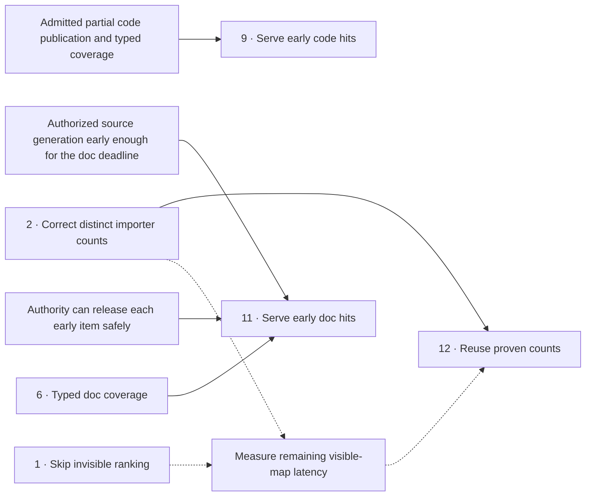

# Index speed implementation ledger

**Start with #1, the compact-map fix.** On the pinned SymForge and Agent_Army_Professionals (AAP) roots, the compact map discarded every key-type line after ranking it. The baseline includes the exact rendered-map hashes and the reproduced 60.09 s AAP daemon failure. The first PR can therefore demonstrate both a speed change and byte-for-byte preservation. [Research report and baseline](REPORT.md#why-compact-maps-cost-seconds)

## Dependency hierarchy

The numbers are stable proposal IDs. Start with #1. Next, pursue #6 and #4 for honest client feedback, and the correctness audit in #2 before changing visible ranking. Start #7’s restore measurement alongside these and compare its measured opportunity with #3 before choosing the next latency PR. #5 can proceed independently on the existing admission path.

A solid arrow denotes a capability required by the proposed behavior. A dotted arrow denotes a result to measure before spending effort. Nodes without a number name prerequisite capabilities or measurements.

#3, #4, #5, #7 and #10 have independent entry points. #8 is retired as scoped. The bulk code publication currently precedes the doc bridge, so even instantaneous extraction cannot produce a 5 s doc hit on a run whose first usable source generation arrives at 8 s. #9 need not ship to satisfy the doc prerequisite if the complete source generation can arrive early enough. #5 can return an admitted project identity with the existing status; rich asynchronous progress requires #4. Verify the combined bind-to-hit flow when both ship.

## Work and proof

**Ready** means work can begin. **Blocked** means a named capability is missing. **Retired** closes only the stated proposal. **Measure** means the next action is a named measurement. **Conditional** means an earlier result determines whether the PR is worth doing. When updating a row, record its PR or commit and the evidence in the last column. Use **Verified** only after the real-client check succeeds. Use **Closed** with a receipt when the target already holds or the experiment fails its acceptance check.

| # | One PR | Requires | Evaluate after | State | Proof to record | Receipt |
|---:|---|---|---|---|---|---|
| 1 | Skip ranking when the budget cuts the whole key-type section | — | — | Ready | Decide from the directory prefix alone with the formatter’s UTF-8 byte and newline rules. Keep ranking if even the blank separator fits. Count eligible type tuples, including several in one file. Compare both footers and every byte at exactly 4,000 prefix bytes and one byte either side. Include 0, 1, 14, 15 and 16 tuples, a lone final type without a newline charge, annotated rows and a first overlong item. On SymForge and AAP clock dependent counting, sorting, total formatter time and client wall time before and after. Profile the residual if a hidden-section map still exceeds 2 s. | — |
| 2 | Audit and correct visible distinct-importer counts | — | — | Measure | Audit the top 15 on SymForge depth 1 using file-level import and re-export evidence; check the OrderSnapshot fixture and watcher import. Build an independent expected set on a minimal Rust graph, including same-stem files, aliases, valid two-hop re-exports, qualified calls and unrelated imports. Fix only demonstrated wrong edges, verify dependent API and corrected map ordering, then remeasure SymForge and cetis.ceregister. | [Observed suspect edge](REPORT.md#independent-review-reconciliation) |
| 3 | Queue mandatory watcher reconciliation behind the first cold reload | — | — | Ready | During cold load create, edit, rename and delete files around watcher registration and force overflow. Time each disk mutation until the new symbol is queryable or the stale path disappears. Compare this interval and first-hit time with baseline. Require each pre-sweep read to match disk or report pending reconciliation, then disk-equivalent settled results. Reject any material edit-visibility or recovery regression. Only defer the sweep if contention after scouting is measured. | — |
| 4 | Expose phase, counters and retry guidance in status and loading replies | — | — | Ready | Drive two real code-mode stdio sessions, probing status while a search is held, through scout, parse, code publication and doc readiness. Verify project and attempt identity, unknown totals, empty roots, failure and cancellation. Check a real read as each phase claims readiness. | — |
| 5 | Bind an unbound local code-mode session to an approved repo | — | — | Ready | Launch from home without client roots. Bind, find known code and doc paths, and replay the bind with the same project identity. Try a disallowed root from a fresh session and verify it stays unbound. Check HTTP restrictions and session isolation, and the public code-mode contract (four names, exact list, 4,800-byte ceiling). Any change to that contract needs an explicit compatibility decision. | — |
| 6 | Return typed, generation-bound knowledge readiness and coverage | — | — | Ready | Capture partial hit, partial miss, complete miss, stale and withheld cases. Compare complete results with the baseline for hit IDs, spans, provenance, ranking and visibility. | — |
| 7 | Shorten snapshot restore to the first correct hit | — | — | Measure | On the same pinned root, clock snapshot read/decode, anchored per-file proof, and post-restore verification separately; also clock hydration, startup-to-hit and verified publication. Contrast strict stdio, local CLI and resident attach. Record actual attach/restore frequency before claiming prevalence. Choose the dominant safe improvement and preserve offline-change, corruption and quarantine outcomes. | [Existing trace and unsplit interval](REPORT.md#publication-reuse-and-workspace-selection) |
| 8 | Skip canonicalization of non-files to bring cold code under 3 s | — | — | Retired | The proposed micro-optimization has no isolated time saving large enough to justify this PR. A future scout investigation can directly time walking, canonicalization and entry probes. Reopen only with evidence of material end-to-hit benefit. | [Review decision](REPORT.md#independent-review-reconciliation) |
| 9 | Serve opt-in, early file-local symbol hits | Admitted partial generation and typed code coverage | — | Blocked | Decide feasibility now. Identify when the first admitted, hash-verified file can safely publish before the whole scout. Prove generation, coverage, an inconclusive early miss, a correct known symbol under 3 s on stdio and unchanged complete/cross-file answers. If this capability cannot be provided, report the residual openly. | [Cold clocks](REPORT.md#cold-phase-profiles-on-the-two-large-repositories) |
| 10 | Extract doc candidates in byte-bounded parallel batches | — | — | Measure | Confirm the deferred bridge is material on the chosen root. On both AAP and moldwright compare bridge time, first verified doc and code hits, and peak bytes. Establish baseline code-hit variation before the alternating runs. Reject a slowdown outside that variation on either root, even if docs hit 5 s. Require the same cards, links, limits, order and authority decisions. | — |
| 11 | Serve screened doc sections before the complete bridge publishes | #6, timely admitted source generation, per-item authority | — | Blocked | Capture every early response. Each early hit’s path, hash, span and rendered evidence bytes must match an authorized item in the complete serial evidence set for the same query and source generation. Exercise a candidate later withheld and require zero early disclosure. Check a verified hit under 5 s, an inconclusive partial miss and identical final ranked results. | — |
| 12 | Reuse exact importer counts across overlapping visible maps | 2 | Visible-map timing after 1 and 2 | Conditional | Measure map calls per immutable publication, their overlapping candidate paths and the frequency of reuse after the first call. Proceed only with meaningful overlap and residual latency. Compare first and repeated map bytes, time and memory; edit an out-of-scope importer, remove a re-export, switch roots and query across publication to catch stale counts. | — |

Preparing match strings once per target and shortlisting qualified calls with existing name postings remain possible performance follow-ups after the visible counts are correct. Measure that pass separately before proposing another PR. [Peer comparison](REPORT.md#projects-that-build-repository-maps-for-coding-agents)

## Fix #1 controls and timeout replay

A standalone probe used the budget helper and both truncation footers from Git revision `3a4fb63d`. It exercised prefix costs from 3,930 through 4,020 UTF-8 bytes, one- and two-row layouts, multibyte text, scoped and unscoped footers, and 0, 1, 14, 15 and 16 type tuples. In **2,730 comparisons**, replacing an entirely hidden section with the same number of placeholder rows exercised 504 skips and changed zero rendered bytes. A deliberately premature cutoff at 3,999 bytes changed 24 responses. Replay on the benchmark host with `uv run --no-project python map-prefix-risk-control.py` from the report’s private replay directory. Terminal Commander job `job_01a20d71085c7799b8b7812ced0747fb` exited 0. The probe supplies the rows directly. Candidate discovery, ranking, and transport still need product-level proof.

1. **Prove the intended work disappeared.** On the pinned SymForge and AAP roots, explicitly request the unscoped compact map with default depth. Record the footer, full rendered digest, eligible type count and number of dependent lookups. Require eligible types and positive lookups on the baseline, identical rendered bytes and zero lookups on the candidate. Also run a scope with a visible annotated type, require a positive lookup count on both versions and compare its complete bytes. Keep diagnostic counters out of the timed release binaries.
2. **Replay the original failure.** Give each matched binary its own daemon and verify client and daemon identities. On an already ready AAP publication, bracket the same default compact-map request with known code hits over persistent stdio. Keep the original transport deadline. Record the first and repeated call wall times, map bytes or exact error, and the surrounding hits. A timeout counts as a failed attempt. Wait for the server-side operation to finish or use a fresh isolated daemon before the next sample so an expired request cannot consume the next run’s worker time.
3. **Locate any remaining delay.** If a hidden-section request still takes 2 s or more with zero lookups, capture the time from request admission to formatter entry, inside the formatter, and from formatter exit to client receipt. Compare with the no-daemon path on the same source tree. Use the longest measured interval to scope the follow-up. Keep the latency target open even if byte equivalence passes.

## When an outcome is complete

| Outcome | Acceptance on the real client |
|---|---|
| Warm map | On the frozen 5,000-file workloads, every measured warm compact map returns in under 2 s with zero timeouts. #1 must return identical bytes at the same generation. Apply the same under-2-s limit to the first map on an already published view and the repeated warm maps. On each large root include an explicit scope with at least one visible type row. Record any intended ranking correction from #2 against its independent oracle. |
| Cold code and docs | Drive a roots-bound code-mode stdio client from initialize, and record CLI timing separately. Time from project open to a known code hit under 3 s and doc hit under 5 s. If using the partial-answer path, capture the useful evidence and truthful coverage the client receives by each deadline, then verify the eventual complete answer. |
| Progress | A waiting client sees the correct phase, counts and retry guidance through completion or failure. Record what the client saw and which reads actually worked. |
| Unbound session | One roots-less session binds an approved repository and finds independently verified code and doc hits. Repeating the operation preserves the project identity. |

Use the pinned revisions, inputs and replay commands in the report. Alternate baseline and one candidate, run at least five fresh starts and twenty warm calls per shape, include failures, and check a held-out repository. Record the binary, root, generation, load source, result fingerprint, wall time and Terminal Commander receipt. Stop a branch of the hierarchy once its outcome holds and its functionality checks pass. [Real-client acceptance protocol](REPORT.md#acceptance-on-the-real-client)
