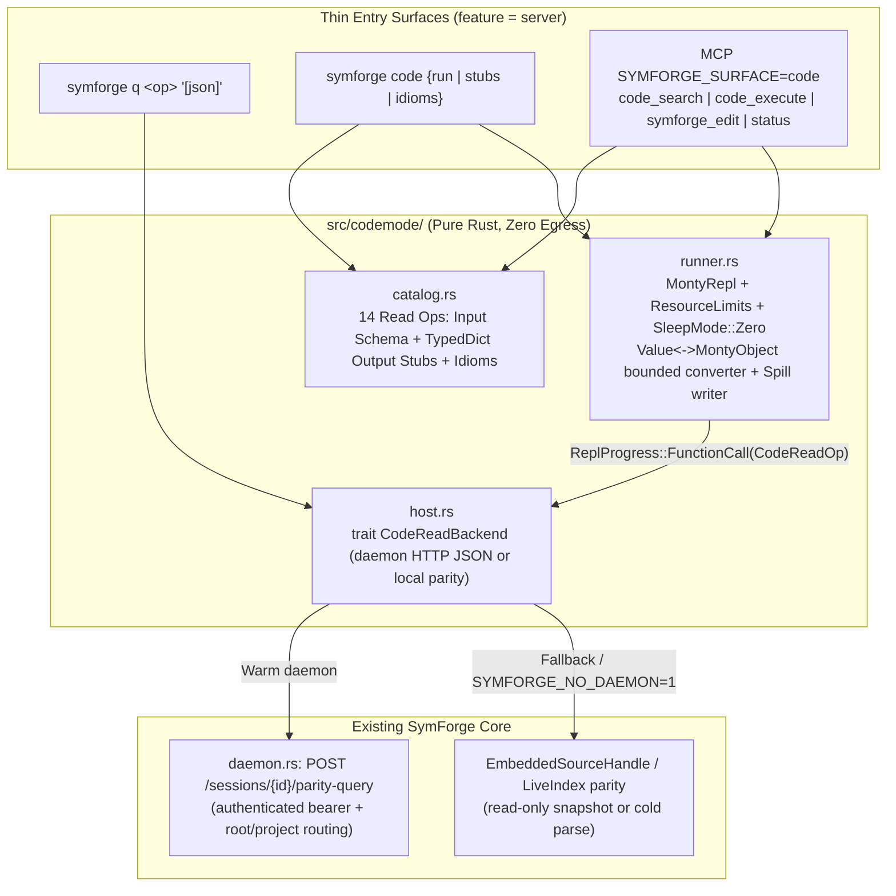

# Implementation Plan: Pure-Rust Code Mode (`symforge code` + `SYMFORGE_SURFACE=code`)

**Branch**: `feat/037-code-mode` | **Date**: 2026-11-21 | **Spec**: [spec.md](spec.md)

**Input**: Feature specification from `specs/037-code-mode/spec.md` and verified Windows MSVC + Rust 1.100.0 `monty` `1.6.0` spike.

## Summary

Add a pure-Rust, zero-egress Python 3.14-subset Code Mode engine (`src/codemode/`, powered by `monty` + `monty-types`) backed directly by SymForge's existing structured `embed::parity::QueryRequest` read projections, exposed through two thin surfaces:
1. **Post-MCP CLI (`symforge code {run,stubs,idioms}` + `symforge q`)**: zero upfront MCP context cost, pure JSON stdout, warm authenticated daemon reuse with read-only local `.symforge/index.bin` fallback.
2. **MCP `SYMFORGE_SURFACE=code` (`symforge serve --surface code`)**: advertises `code_search`, `code_execute`, `symforge_edit`, and `status` (≤ 4,800 bytes / ~1,200 tokens upfront vs 69,295 bytes on `full`), keeping mutations atomic and explicit outside the sandbox.

Shipped in four small, independently testable slices, gated on `specs/035-token-benchmark/` whole-task token and oracle pass-rate proof before enabling default skill installation.

## Technical Context

- **Language / Toolchain**: Rust 2024 edition (`rust-toolchain.toml` channel `1.100.0`), `unsafe_code = "deny"`, `warnings = "deny"`.
- **New Dependencies** (`server`-feature optional, excluded from `embed`):
  - `monty = { version = "1.6", optional = true }`
  - `monty-types = { version = "1.6", optional = true }`
  - Verified on `x86_64-pc-windows-msvc`: pure Rust (`ruff_python_parser` + bytecode VM, zero C/C++ build scripts, zero `stacker` asm), ~11.0 MiB stripped LTO footprint delta, 65 µs `MontyRepl` init, `cargo deny check advisories` clean against repo `deny.toml` (`RUSTSEC-2026-0543` already ignored).
- **Storage**: None new. Reuses existing `.symforge/index.bin` snapshots and daemon `ProjectSlot` / `EmbeddedSourceHandle` parity queries. Overflow output spills to OS temp dir (`symforge-code-spill-<pid>-<seq>.json`).
- **Testing**:
  - `cargo test --lib --bins --tests -- --test-threads=1`
  - `cargo build --no-default-features --features embed` + `cargo test --no-default-features --features embed --lib -- --test-threads=1`
  - `cargo deny check advisories`
  - `python research/token-benchmark/bench.py dry-run` (and live calibration/matrix for arms `d` and `e`).
- **Constraints**:
  - `specs/020-repository-knowledge-index/` frozen V11 public API (`symforge::embed`, `symforge::server_api`) untouched (`execution/refreeze_v11.py verify-internal` stays green).
  - `tests/conformance.rs` (`EXPECTED_TOOLS`), `src/cli/init.rs` (`SYMFORGE_TOOL_NAMES`), `src/stel/surface.rs`, and `tests/surface_default.rs` updated in lockstep for `code_search` / `code_execute` (filtered out of `SurfaceProfile::Full` just like compact-only `symforge`, so `full_surface_advertises_exactly_40_tools` remains exact at 40!).
  - `tests/preventive_runtime_dark_v11.rs` (`WIRED_PRODUCTION_FILES`, `src/internals.rs` `#[path]` allowlist, and `tests/darkness_baseline/full_source.pins`) refreshed cleanly in each slice.

## Constitution Check

| Principle | How this plan meets it |
|---|---|
| I. Reporting invariant | No unmeasured token-savings strings printed; `symforge code run` reports exact observed `calls`, `duration_ms`, and `output_bytes`; whole-task efficiency claims gated on `035-token-benchmark` paired runs. |
| II. RED-first evidence | Every slice lands failing unit/integration tests first (sandbox escape/timeout/memory caps, stub/idiom drift test, surface dispatch gate, daemon vs no-daemon parity). |
| III. Frozen contracts win | `public-api-v11.json` untouched; `SurfaceProfile::Full` keeps advertising the exact 40 tools (`code_search` and `code_execute` are filtered off `Full` alongside `symforge`). |
| IV. Verification gates | Executed through Terminal Commander (`run_and_watch` / `command_start_combed`), one heavy Cargo job at a time, including `embed` doorless + door-open gates and `preventive_runtime_dark_v11`. |
| V. Unrepresentable over checked | Sandbox host table binds an enum `CodeReadOp` mapping 1-to-1 to read-only `embed::parity::QueryRequest` variants—mutating operations cannot be represented or dispatched inside `CodeModeRunner`. |
| VI. Independent review | Each slice PR runs `rust-pro` implementation + `verifier` + `code-reviewer` + `security-reviewer` (for sandbox/boundary slice S1). |

## Architecture & Data Flow



## Canonical Sandbox Function Set (`CodeReadOp`, 14 Read-Only Functions)

All functions are keyword-only in Python (`fn(*, arg=...) -> dict | list[dict]`) and return clean JSON-compatible dictionaries/lists directly from `embed::parity`:

| Python Function | Backing `embed::parity::QueryRequest` | Primary Return Shape (`TypedDict`) |
|---|---|---|
| `search_symbols` | `SymbolSearch(SymbolSearchRequest)` | `list[SymbolHit]` (`path`, `name`, `kind`, `start_line`, `end_line`, `signature`) |
| `get_symbol` | `SymbolRead(SymbolReadRequest)` (single or `targets=[...]`) | `list[SymbolBody]` (`path`, `name`, `kind`, `start_line`, `end_line`, `source`, `doc`) |
| `find_references` | `ReferenceSearch(ReferenceSearchRequest)` | `list[RefHit]` (`path`, `name`, `kind`, `start_line`, `enclosing_symbol`, `class`) |
| `find_dependents` | `DependentSearch(DependentSearchRequest)` | `list[DependentHit]` (`path`, `line`, `kind`) |
| `file_context` | `FileContext(FileContextRequest)` | `FileContextOut` (`path`, `language`, `symbols`, `imports`, `consumers`) |
| `file_content` | `FileContent(FileContentRequest)` | `FileContentOut` (`path`, `start_line`, `end_line`, `total_lines`, `content`) |
| `search_text` | `TextSearch(TextSearchRequest)` | `list[TextHit]` (`path`, `line`, `preview`, `enclosing_symbol`) |
| `search_files` | `FileSearch(FileSearchRequest)` | `list[FileHit]` (`path`, `score`) |
| `repo_map` | `RepoMap(RepoMapRequest)` | `RepoMapOut` (`entries`, `truncated`) |
| `symbol_context` | `SymbolContext(SymbolContextRequest)` | `SymbolContextOut` (`symbol`, `callers`, `callees`, `type_usages`) |
| `inspect_match` | `InspectMatch(InspectMatchRequest)` | `InspectMatchOut` (`path`, `line`, `enclosing_symbol`, `siblings`) |
| `what_changed` | `WhatChanged(WhatChangedRequest)` | `WhatChangedOut` (`files`, `symbol_changes`) |
| `diff_symbols` | `DiffSymbols(DiffSymbolsRequest)` | `DiffSymbolsOut` (`changes`) |
| `detect_impact` | `DetectImpact(DetectImpactRequest)` | `DetectImpactOut` (`affected_symbols`, `affected_files`) |
| `search_knowledge` | `SearchKnowledge(SearchKnowledgeRequest)` | `list[KnowledgeHit]` (`path`, `heading`, `snippet`, `authority`) |

*(15 read-only functions total; zero write/index/remediation functions.)*

## Source Layout

```text
src/
├── internals.rs                     # mount #[cfg(feature = "server")] #[path = "codemode/mod.rs"] pub mod codemode;
├── lib.rs                           # pub(crate) / __test-internals re-import for codemode (server-only)
├── codemode/
│   ├── mod.rs                       # public(crate) types: CodeModeLimits, ExecuteRequest, ExecuteOutcome
│   ├── catalog.rs                   # CodeReadOp enum (15 ops), Python stub + TypedDict generator, idioms text
│   ├── value.rs                     # bounded serde_json::Value <-> MontyObject arena conversion (depth <= 126, <= 10 MiB)
│   ├── runner.rs                    # MontyRepl driver: limits, SleepMode::Zero, OsCall refusal, spill-on-overflow
│   └── backend.rs                   # CodeReadBackend trait: LocalParityBackend + DaemonParityBackend
├── daemon.rs                        # authenticated POST /code-query endpoint returning typed parity JSON
├── cli/
│   ├── mod.rs                       # Commands::Code(code::CodeCliArgs), Commands::Query(code::QueryCliArgs) (`symforge q`)
│   ├── entry.rs                     # dispatch Commands::Code and Commands::Query
│   ├── serve.rs                     # optional `--surface <full|core|compact|code>` flag
│   ├── init.rs                      # `--code-skill` opt-in skill writer + SYMFORGE_TOOL_NAMES sync
│   └── code.rs                      # NEW: CLI handlers for `symforge code {run,stubs,idioms}` and `symforge q`
├── stel/
│   └── surface.rs                   # SurfaceProfile::Code, CODE_TOOL_NAMES = ["code_search","code_execute","symforge_edit","status"]
└── protocol/
    ├── surface_probe.rs             # CODE_SURFACE_INSTRUCTIONS, code_surface_tools(), enforce_surface_gate(), Full filter
    ├── mod.rs                       # route `code_search` / `code_execute`
    └── tools.rs                     # #[tool(name = "code_search")] and #[tool(name = "code_execute")]

tests/
├── codemode_sandbox.rs              # NEW: S1 adversarial sandbox, limits, value conversion, spill tests
├── codemode_parity_cli.rs           # NEW: S2 `symforge code` & `symforge q` (warm daemon + local fallback + secret withholding)
├── codemode_mcp_surface.rs          # NEW: S3 `SYMFORGE_SURFACE=code` schema byte budget, dispatch gate, e2e chains
└── preventive_runtime_dark_v11.rs   # allowlist updates + refreshed full_source.pins
```

## Implementation Slices

Each slice is one reviewable PR with RED-first tests and full CI gate verification:

| Slice | Scope | Key Deliverables & Acceptance Checks |
|---|---|---|
| **S1: Sandbox & Stub Engine** (`src/codemode/{mod,catalog,value,runner}.rs`) | Pure-Rust `monty` engine + typed stub/idiom catalog over a mock/in-memory `CodeReadBackend`. | • `Cargo.toml` adds optional `monty` + `monty-types` to `server`.<br/>• `tests/codemode_sandbox.rs` proves: loop timeout (`TimeoutError`), memory bomb pre-check (`MemoryError`), recursion cap, call count cap (64), `open()`/`os` blocked (`PermissionError`), `time.sleep` zeroed, positional kwargs `TypeError`, 16k output spill file, and zero stub/idiom drift.<br/>• `embed` feature build proven untouched (`monty` not compiled). |
| **S2: Post-MCP CLI (`symforge code` + `symforge q`) & Daemon JSON Lane** | Wire `CodeReadBackend` to `embed::parity` (both warm daemon HTTP JSON route and read-only local snapshot fallback) + CLI subcommands. | • `symforge code idioms`, `symforge code stubs [query]`, `symforge code run`, and `symforge q <op> '<json>'`.<br/>• `tests/codemode_parity_cli.rs` proves identical JSON output between warm daemon and `SYMFORGE_NO_DAEMON=1`, secret-withholding parity (`#927`/`#929`), and non-frecency on discovery ops. |
| **S3: MCP `SYMFORGE_SURFACE=code` & `serve --surface code`** | Add `SurfaceProfile::Code`, `code_search` + `code_execute` MCP tools, dispatch gating, and opt-in `symforge init --code-skill`. | • `tools/list` on `SYMFORGE_SURFACE=code` advertises 4 tools (`≤ 4,800` bytes); `SurfaceProfile::Full` stays at **exact 40 tools** (`tests/surface_default.rs` passes).<br/>• Unlisted legacy tools rejected at `tools/call` on `code` surface.<br/>• Connection surface header `"code"` threaded across daemon proxy. |
| **S4: Standing Benchmark Arms (`035-token-benchmark`)** | Add arms `d` (`SYMFORGE_SURFACE=code`) and `e` (`symforge code` CLI skill, `mcp: false`) to `research/token-benchmark/`. | • `bench.py dry-run` + unit suite pass with allow-list enforcement.<br/>• Run live paired comparison (`native` vs `full` vs `compact` vs `code` vs `cli-code`) and record run ID + category medians before deciding default `init` behavior. |

## Risks & Mitigations

1. **Monty Python subset surprises (`yield`, `del`, `@property`, `async for` rejected at parse time):**
   - Monty rejects unsupported syntax **before executing a single instruction** with a clear `NotImplementedError` line/column message. `symforge code idioms` and `CODE_SURFACE_INSTRUCTIONS` state the exact 3-line idiom (comprehensions, plain `for`/`if`, synchronous `fn(**kwargs)` calls), so models self-correct or avoid unsupported constructs on attempt 1.
2. **Thread stack overflow on deeply nested Python ASTs/JSON without `stacker`:**
   - We omit `stacker` (which pulls C/asm) to preserve pure Rust and `unsafe_code = "deny"`. Instead, `DEFAULT_MAX_RECURSION_DEPTH = 150`, `MAX_VALUE_DEPTH = 126`, iterative heap-based JSON drop (`drop_json`), and running `MontyRepl` inside `tokio::task::spawn_blocking` (2 MiB default OS thread stack on Windows and Linux) keep stack usage bounded with wide safety margin; tested explicitly in `tests/codemode_sandbox.rs`.
3. **V11 Darkness & Source-Pin Gate (`preventive_runtime_dark_v11.rs`):**
   - Adding `pub mod codemode;` in `src/internals.rs` uses `#[path = "codemode/mod.rs"]` (flagged by `source_splicing_is_allowlisted`), and `src/codemode/backend.rs` calling `crate::embed::parity` / `index_lifecycle` requires registering the exact file in `WIRED_PRODUCTION_FILES` and regenerating `tests/darkness_baseline/full_source.pins`. Keeping `codemode/backend.rs` calling the public-in-crate `crate::embed` facade (`ProcessIndexRuntime` / `EmbeddedSourceHandle` or `SymForgeServer` parity helpers) minimizes darkness allowlist churn.
